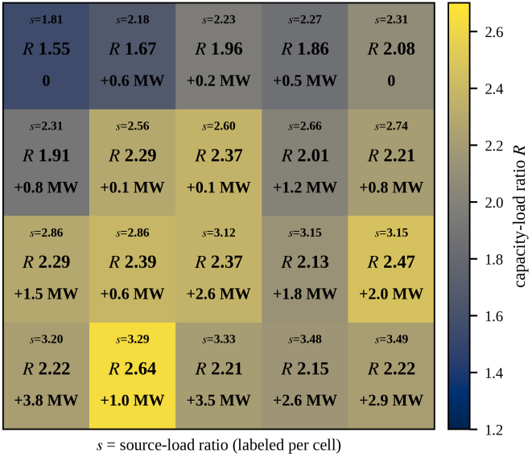

# EPG-NSGA-II_MIND2026_CameraReady_v4

# Engineering-Prior-Guided NSGA-II for

# Differentiated Capacity-Load Ratio Optimization in

# County-Level 110 kV Grids with High Distributed PV Penetration

2ndKe Wang 3rdYan Xu* 1stDunbin Xu *State Grid Xuzhou Power Supply* *State Grid Xuzhou Power Supply* *State Grid Jiangsu Electric Power* *Company* *Company* *Design & Consulting Co., Ltd. Xuzhou* Xuzhou, China Xuzhou, China *Survey and Design Branch* xzam@163.com 17851199257@139.com Xuzhou, China xuyan9999@163.com *Corresponding Author 4thZiyue Huang 5thFei Geng 6thRui Yuan *State Grid Jiangsu Electric Power* *State Grid Jiangsu Electric Power* *State Grid Jiangsu Electric Power* *Design & Consulting Co., Ltd. Xuzhou* *Design & Consulting Co., Ltd. Xuzhou* *Design & Consulting Co., Ltd. Xuzhou* *Survey and Design Branch* *Survey and Design Branch* *Survey and Design Branch* Xuzhou, China Xuzhou, China Xuzhou, China 792572118@qq.com 2362324393@qq.com 450532913@qq.com ***Abstract— *High penetration of distributed photovoltaic (PV)** II. ENGINEERING-PRIOR-GUIDEDNSGA-II **systems causes reverse power flow and affects N-1 supply** *A. Planning Model* **adequacy in county-level 110 kV grids. This study jointly** **optimizes substation-specific capacity-load ratios (CLRs) and** The county-level grid contains*K*110 kV substations. At **storage power ratings to minimize annualized cost and** station*j*,*R**j*is the CLR (planned transformer capacity over **expected** **energy not** **supplied** **(EENS).** **The** **proposed** *p*the forecast peak load),*P**j*the storage power rating, and*L**j* **Engineering-Prior-Guided NSGA-II (EPG-NSGA-II) combines** five-year forecast peak load using a 5% annual growth **engineering-prior-based population seeding with feasibility** planning assumption. Station CLRs obey the load-weighted **repair. On a county-level test system, EPG-NSGA-II identifies** aggregate band.

**an elastic CLR design that reduces annualized cost by 3.4%** **0**;

At station*j*, pre-storage midday reverse injection is*r**j* **and modeled EENS to zero relative to the 2.0-capped CLR** **design. EPG-NSGA-II achieves a 4.8% higher mean final** after storage absorption, residual reverse flow is **hypervolume than standard NSGA-II for the 40-substation** **+**.

**0 -***P**j*] (1) *r*̃*j*(*P**j*)**=**[*r**j* **case.** Here,[*x*]+=max{0,*x*}. With*R**L*=1.8 and*R**U*=3.0, the load- ***Keywords—capacity-load ratio, penetration of distributed*** weighted aggregate CLR is constrained as ***photovoltaic, multiobjective optimization, reverse power flow, 110*** ***kV grid planning.*** *p* *K* *R**j* *L**j* ∑ *j*=1 *R**L*≤ ≤*R**U*.

(2) I. INTRODUCTION *p* *K* *L**j* ∑ *j*=1 High penetration of distributed PV causes midday export With*β*=0.85 ,*R*220=1.8 ,*δ*=0.85 , and*η*=1.0 denoting the and reverse power flow at 110 kV substations [1], reverse-loading limit, upper-level CLR, load-coincidence potentially affecting supply adequacy under N-1 factor, and reverse-power coincidence factor, respectively, contingencies. A fixed CLR cap of 2.0 cannot reflect the station and optional upstream reverse-flow constraints substation-level differences in PV penetration and transfer are capability [2]. Multiobjective evolutionary algorithms *p*, *r*̃*j*(*P**j*)≤*βR**j**L**j* approximate cost–adequacy trade-offs [3], while *K* *K* knowledge-transfer strategies improve search efficiency [4], (3) *p* .

𝜂∑*r*̃*j* (*P**j*)≤*βR*220*δ*∑*L**j* [5]. However, neither explicitly handles the joint CLR and reverse-flow constraints in this planning problem, so *j*=1 *j*=1 infeasible candidates remain common.

Annualized cost*f*1and EENS*f*2are minimized as EPG-NSGA-II addresses this gap by augmenting min(*f*1,*f*2), standard NSGA-II with engineering-prior-based population *K* seeding and feasibility repair. The bi-objective model jointly *p*+*c**P**P**j*+*C**j* *loss*+*C**j* *om*, *f*1=∑*c**R**R**j* *L**j* optimizes substation-specific CLRs and storage power (4) *j*=1 ratings subject to aggregate-CLR and reverse-flow *K* constraints, minimizing annualized cost and EENS. EENS .

*f*2=∑*EENS**j* quantifies supply inadequacy under N-1 contingencies rather than imposing a hard N-1 constraint. Comparative and *j*=1

*loss*and*C**j*

*om*are annual loss

ablation studies use a county-level test system constructed

Here,*c**R*and*c**P*are unit costs;*C**j*

from publicly available data.

and O&M costs. For outage state*s*∈Ω*j*at substation*j*,*p**s*, h*s*,

and*S**j*,*s*denote occurrence probability, duration, and

available supply, respectively; the resulting EENS is

<!-- Page 2 -->

*C. CLR Comparison at**K = 20* *p*-*S**j*,*s*}.

*EENS**j*=∑*p**s* h*s*max{0,*L**j* (5) Using the same knee-point selection rule for both Pareto *s*∈𝛺*j* sets, the elastic CLR design reduces annualized cost from 236.40 to 228.43 million CNY/yr and modeled EENS from *B. EPG-NSGA-II Procedure* 561 to 0 MWh/yr relative to the 2.0-capped CLR design.

EPG-NSGA-II retains standard NSGA-II variation and The source-load ratio, defined as installed PV capacity selection [3]. Algorithm 1 applies common-offset seeding divided by current peak load, is positively associated with plus station-level and optional upstream repair; the same the selected CLR, while storage is used as a supplement (Fig.

repair is applied after variation.

1. .

**Algorithm 1**Engineering-Prior-Based Seeding and Feasibility Repair

**Input: population size***N*;*K*substations; bounds*R**min*≤*R**i*,*j*≤*R**max*and 0≤*P**i*,*j*≤*P**max*.

Indices𝑖and𝑗denote individuals and substations, respectively;

*R**i*,*j*∼*U*([*R**min*,*R**max*])denotes uniform sampling; clip applies the stated bounds; ← denotes assignment.

**Output:***N*repaired candidates.

**for**i=1,…,N**do** 1:

**if constructing the initial population then** 2:

Sample*R**i*,*j*∼*U*([*R**min*,*R**max*])and set*P**i*,*j*=0for all𝑗 3:

**else** 4:

Retain the post-variation offspring values 5:

**end if** 6:

Apply a bounded common offset to all*R**i*,*j*until (2) holds 7:

8:

Update*P**i*,*j*using the station-level repair rule:

+},0,*P**max*) *p*] 0-*βR**i*,*j**L**j* *P**i*,*j*←*clip*(*max*{*P**i*,*j*[*r**j* Order substations by descending residual reverse injection 9:

10: **if the upstream constraint is enabled then** 11: Increase adjustable*P**i*,*j*until the upstream inequality in (3) holds or all adjustable ratings reach*P**max* 12: **end if** 13: Save*R**i*,*j*and*P**i*,*j*as candidate*i* 14: **end for** 15: **return**𝑁repaired candidates The common-offset adjustment is defined as *R**i*,*j*←clip(*R**i*,*j*+*λ**i*,*R**min*,*R**max*)， (6) Fig. 1. Differentiated CLRs and storage ratings for the𝐾=*20*case.

where*λ**i*enforces the load-weighted aggregate CLR in (2).

After station-level storage repair, the upstream violation is IV. CONCLUSION + *K* *K* EPG-NSGA-II attains a 4.8% higher mean final HV than *p* (7) *v**up*(*x**i*)=[*η*∑ *r*̃*j*(*P**i*,*j*) -*βR*220*δ*∑ *L**j* .

] standard NSGA-II at*K = 40*, while the elastic CLR design *j*=1 *j*=1 reduces annualized cost by 3.4% and modeled EENS to zero When*v**up**>*0, storage is allocated in descending residual- under the current model relative to the 2.0-capped CLR injection order until*v**up**=*0 or adjustable ratings reach*P*max.

design. Future work will add storage energy/SOC limits and real-grid calibration.

Residual infeasibility is handled by constraint domination.

REFERENCES These operators modify only candidate construction and repair; standard NSGA-II ranking and environmental [1]   Q. Hou, N. Zhang, E. Du, M. Miao, F. Peng, and C. Kang, “Probabilist ic duck curve in high PV penetration power system: Concept, modelin selection remain unchanged.

g, and empirical analysis in China,” Applied Energy, vol. 242, pp. 205 –215, 2019, doi: 10.1016/j.apenergy.2019.03.067.

III. EXPERIMENTS [2]   J. Xiao, R. Liu, and M. Long, “Relationship between substation capaci *A. Setup* ty-load ratio and the next-level medium-voltage distribution network,” Station-level loads are generated by scaling the IEEE Electric Power Construction, vol. 36, no. 11, pp. 45–50, 2015 (in Chi nese).

33-bus load data [6], and PV profiles are derived from [3]   K. Deb, A. Pratap, S. Agarwal, and T. Meyarivan, “A fast and elitist m PVGIS irradiance [7]. The population size is*N = 100*, with ultiobjective genetic algorithm: NSGA-II,” IEEE Trans. Evol. Compu three independent runs. Standard NSGA-II and NSGA-III t., vol. 6, no. 2, pp. 182–197, 2002.

use an 800-generation reference budget; EPG-NSGA-II and [4]   X. Xue, C. Yang, Y. Hu, K. Zhang, Y.-M. Cheung, L. Song, and K. C.

its ablations use 400 generations.

Tan, “Evolutionary sequential transfer optimization for objective-hete rogeneous problems,” IEEE Trans. Evol. Comput., vol. 26, no. 6, pp. 1 *B. Efficiency and Ablation* 424–1438, 2022.

[5]   X. Xue, Y. Hu, L. Feng, K. Zhang, L. Song, and K. C. Tan, “Surrogate TABLEI. NORMALIZEDMEANFINALHYPERVOLUME(HV) -assisted search with competitive knowledge transfer for expensive opt **Method** ***K *=10** ***K *=20** ***K *=30** ***K *=40** imization,” IEEE Trans. Evol. Comput., vol. 29, no. 6, pp. 2416–2430, NSGA-II 1.000 1.000 1.000 1.000 NSGA-III 0.998 0.991 0.979 0.985 [6]   M. E. Baran and F. F. Wu, “Network reconfiguration in distribution sy Seeding-only 0.996 0.991 0.988 0.998 stems for loss reduction and load balancing,” IEEE Trans. Power Del., Repair-only 1.004 1.006 1.008 1.048 vol. 4, no. 2, pp. 1401–1407, 1989.

EPG-NSGA-II 1.007 1.007 1.009 1.048 [7]   European Commission, Joint Research Centre, “Photovoltaic Geograp Table I reports mean final HV at each method's hical Information System (PVGIS).” [Online]. Available: https://re.jrc.

ec.europa.eu/pvg_tools/en/.

termination, normalized by standard NSGA-II for each*K* using a common reference point. EPG-NSGA-II matches or exceeds the baseline, yielding a 4.8% improvement at K =

40. Repair-only nearly matches the full method, whereas

seeding-only remains close to the baseline. At*K = 40*, the

mean EPG-NSGA-II curve reaches the standard NSGA-II

800-generation final HV by generation 84.
