# 徐州110kV容载比弹性指标优化研究_成果汇报初稿

- Source: `徐州110kV容载比弹性指标优化研究_成果汇报初稿.pptx`
- Total slides: 36

## Slide 1

徐州地区分布式新能源高渗透率地区
110 kV电网容载比弹性指标优化研究
成果汇报

国网江苏电力设计咨询有限公司
徐州勘测设计分公司
2026年10月

### Speaker Notes

本次汇报围绕分布式新能源高渗透率下110 kV电网容载比与双向容量需求的协调问题，介绍运行特征、工程成本、联合配置结果及规划应用建议。

## Slide 2

一

研究背景

二

研究目标和思路

三

研究内容

四

实证分析

五

项目成效

- 2

### Speaker Notes

汇报分为五部分。首先说明规划问题和研究思路，然后介绍运行分析与成本模型，重点报告两地区逐年方案及五参数推荐范围，最后说明成果和应用条件。

## Slide 3

1

研究背景

1.1 背景与规划问题

光伏接入使主变同时承担正向供电与反向输送任务

日间：本地消纳与余电反送

晚间：上级电网供电

反向容量校核

正向峰值与主变N-1校核

容载比由区域容量与年网供最大负荷共同决定，具体增容需联系站级任务。

依据：研究报告1.1—1.2；《配电网规划设计技术导则（修订稿，2025年4月）》

- 3

### Speaker Notes

光伏出力较高时，本地负荷由分布式电源供给，剩余功率可能通过主变向上级电网反送。晚间光伏退出后，主变仍承担正向供电。研究据此把区域容载比与逐站正反向容量、主变N-1和站间支援联系起来。

## Slide 4

2

研究目标和思路

2.1 研究目标与思路

把片区推荐值落实为满足供电任务的工程配置

运行资料

运行任务

工程费用

年度容量、同范围负荷与光伏
，46座站设备和转供资料

识别正向、反向及局部高峰，
保持同小时功率关系

主变、联络、储能按统一范围
及投运批次计费

联合比选

结果解释

条件推荐

逐年承接已投运设备，校核正
常与主变N-1条件

用设备组合、投运时点和分项
费用解释差异

从十三项候选指标归纳五项参
数与查表范围

资料、约束、费用和建设安排逐项衔接，形成“一片一策”的容量规划依据。

依据：研究报告1.4—1.5、图1-1

- 4

### Speaker Notes

研究先从年度统计和站级资料识别运行任务，再用真实工程造价建立统一费用模型。在相同供电条件下联合选择主变、联络和储能，通过逐年设备与费用结果解释弹性容量的作用，并归纳五参数推荐范围。

## Slide 5

3

研究内容

3.1 研究对象与数据

邳州与市区分别体现高光伏县域和负荷集中城区

| 2025年指标 | 邳州 | 市区 |
| --- | --- | --- |
| 站级分析范围 | 20座110 kV站 | 26座110 kV站 |
| 实际主变容量 / MVA | 2139.50 | 3701.00 |
| 年网供最大负荷 / MW | 956.45 | 1528.82 |
| 装机渗透率估计值 | 1.63 | 0.32 |
| 电量渗透率估计值 | 40% | 9% |

2021基期 → 2022—2025历史回算 → 2026—2035预测条件规划

时序样本补齐为8760小时；年度规划峰值沿用同范围年度统计与预测输入。

依据：研究报告3.1、表3-12、表5-1

- 5

### Speaker Notes

两地区保留各自源荷与设备特征，站级分析覆盖邳州20座和市区26座110 kV变电站。历史统计用于描述现状，逐年方案以2021年实际容量为共同起点。时序样本按报告方法补齐为8760小时，装机和电量渗透率中相应估计范围保留。

## Slide 6

3

研究内容

3.2 历史容量与负荷

两地区容载比变化反映不同的建设与负荷发展过程

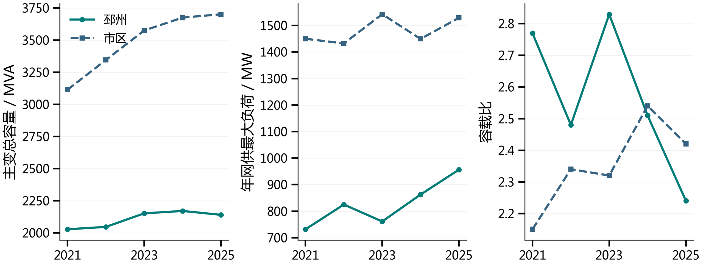

邳州负荷增长快于容量增长；市区容量投放与负荷回落共同影响年度比值。

依据：研究报告表3-1、表3-2、表3-24

- 6

### Speaker Notes

2021—2025年邳州主变容量增加112.50 MVA，年网供最大负荷增加224.68 MW，容载比由2.77降至2.24。市区同期容量增加587.50 MVA，负荷增加79.05 MW，容载比由2.15升至2.42。比值需同时联系容量和负荷，而年度回落年份还应保留已投运设备的作用。

## Slide 7

3

研究内容

3.3 光伏发展与渗透率

光伏规模及供能水平差异形成不同的双向运行任务

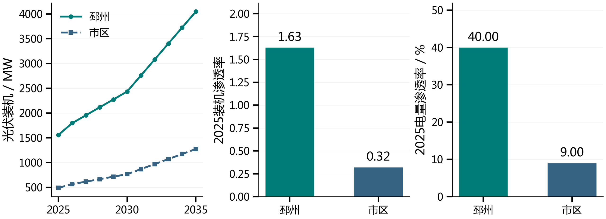

邳州2025年装机渗透率约1.63、电量渗透率约40%；市区分别约0.32、9%。

依据：研究报告3.3、表3-6、表3-12

- 7

### Speaker Notes

邳州2025年末光伏装机为1559.64 MW，市区为491.18 MW。两地区的装机和电量渗透率表明，邳州更需关注日间反送。未来光伏按报告的全市相对发展比例形成情景，并与负荷预测分别输入。

## Slide 8

3

研究内容

3.4 净负荷与近峰特征

正反向峰值及持续过程共同决定容量与支撑需求

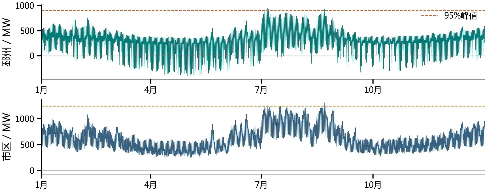

95%峰值：邳州最长连续2 h、累计7 h；市区最长连续6 h、累计11 h。

区域峰值先同小时汇总站级功率，再取绝对值；近峰时长在补齐序列上统计。

依据：研究报告3.4、表3-10；保留补值标识的区域8760小时序列

- 8

### Speaker Notes

净负荷受入为正、反送为负，图中保留补齐后的全年序列。近峰阈值为区域净负荷绝对峰值的95%，邳州最长连续2小时、市区6小时。该统计描述运行过程，年度容载比仍使用年度统计峰值。

## Slide 9

3

研究内容

3.5 站级容量压力

区域容量储备与少数站点的局部压力可以同时存在

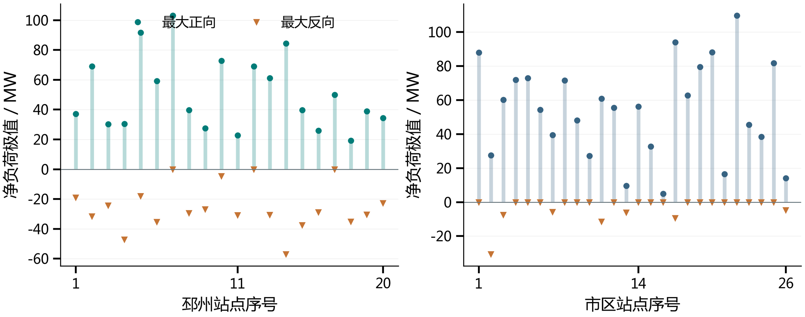

站级极值逐站比较，配置比选继续校核同期源荷、主变结构和邻站承接余量。

依据：研究报告表3-8、表3-22、表3-23

- 9

### Speaker Notes

46座站的正反向极值展示了容量任务在空间上的差异。邳州有4座站反向幅值较大，市区有1座，其他站以正向任务为主。站级负载率是按容量和功率因数折算的计算指标，与逐台设备实测年最大负载率分别使用。

## Slide 10

3

研究内容

3.6 核心指标筛选

十三项指标经组内筛选与高相关归并形成五项参数

候选指标

13

源荷、网络、时间及费
用

达到组内筛选要求

9

相关绝对值不低于0.40

保留基础规划输入

5

高相关归并阈值0.70

研究采用节点等权，保留零容量响应组；两个阈值用于推广维度归纳。

依据：研究报告3.5、表3-14—3-20

- 10

### Speaker Notes

首先在固定其他条件的受控组内，计算候选指标与容载比的Pearson相关，保留零容量响应组。十三项中九项达到绝对值0.40，再以参数间绝对值0.70归并信息重叠较多的组，优先采用具有明确规划含义的基础输入，形成五项推广参数。

## Slide 11

3

研究内容

3.7 参数核验与分档

五项参数分别保留不同规划条件的信息

| 参数 | 矩阵分类 |
| --- | --- |
| 装机渗透率 | ≤1；(1,2]；>2 |
| 年最大净负荷平均增长率 | ≤2%；(2%,4%]；(4%,7%]；>7% |
| 电缆长度占比 | ≤10%；(10%,30%]；>30% |
| 初始转供率 | ≤30%；(30%,50%]；(50%,70%]；>70% |
| 负荷分散系数 | ≤1.15；>1.15 |

有效情景库内最大参数间Pearson绝对值为0.29，相关性结合计算关系解释。

依据：研究报告表3-19、表3-21

- 11

### Speaker Notes

五项参数为装机渗透率、年最大净负荷平均增长率、电缆长度占比、初始转供率和负荷分散系数。有效情景库中最大参数间相关绝对值为0.29，五项保留电源规模、负荷发展、线路经济条件、既有支援和局部峰值分布的信息。

## Slide 12

3

研究内容

3.8 工程费用模型

工程投资按采购规模、项目数量和投运时点计取

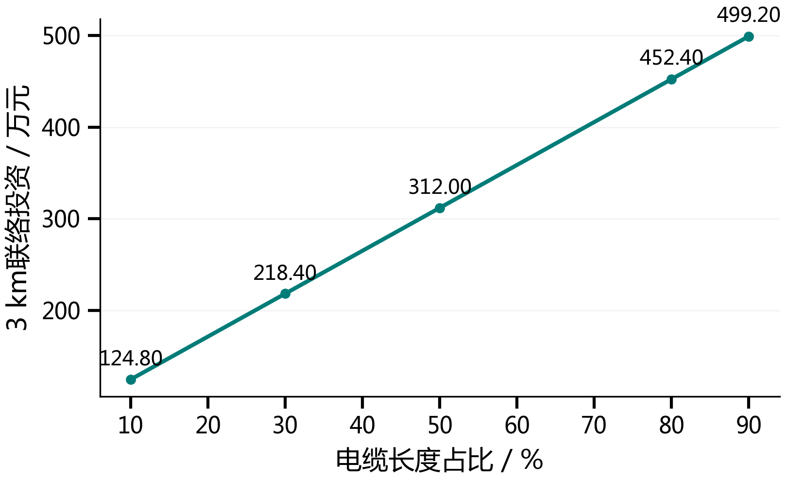

主变更换

按整台新购铭牌容量计价；净增容
量扣除同期被替换容量

主变扩建

50 MVA扩建项目参考投资1223.00
万元

新增联络

按地区电缆长度占比折算3 km单项
费用，既有工程不重复计费

邳州、市区单项新增联络参考投资分别为128.38、452.40万元。

依据：研究报告4.2—4.3、表4-2、表4-3

- 12

### Speaker Notes

主变更换按整台新购容量计价，扩建按完整项目投资计价，新购容量与净增容量分别反映采购费用和区域容量变化。联络按实际新建条数与地区综合造价计费。三类措施后续统一按投运批次计算评价期费用。

## Slide 13

3

研究内容

3.9 储能有效支撑

额定功率与可用电量共同限制持续支撑能力

有效支撑功率 = min（额定功率，可用电量 ÷ 支撑时间）

可用电量系数0.76：结合SOC可用窗口与单向放电效率

柜型：100 kW / 215 kWh；参考投资：21.05万元/柜

| 额定配置 | 2 h有效功率 | 4 h有效功率 | 6 h有效功率 |
| --- | --- | --- | --- |
| 1.00 MW / 2.15 MWh | 0.82 MW | 0.41 MW | 0.27 MW |

地区正向支撑取邳州2 h、市区6 h，反向吸收按对应可充电空间与持续要求。

依据：研究报告4.4—4.6、表4-4、表4-5

- 13

### Speaker Notes

储能支撑同时受功率和可用电量约束，研究取可用电量系数0.76。对额定1 MW、2.15 MWh配置，2、4、6小时有效支撑分别为0.82、0.41、0.27 MW。时间条件改变可用支撑规模，工程投资仍按新增整数柜及统一单价计取。

## Slide 14

3

研究内容

3.10 三类措施联合配置

主变、联络与储能在相同安全约束下共同承担任务

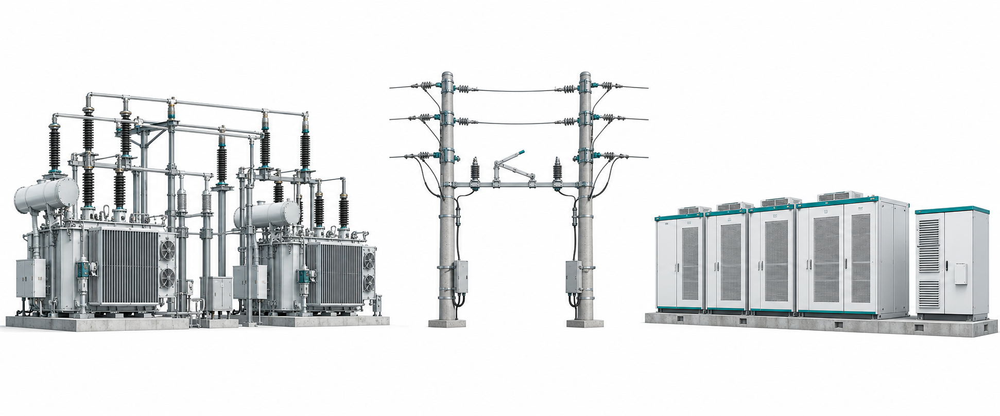

主变补强

联络支援

储能支撑

本站与故障后剩余能力

区段、通道及受端余量

功率与可用电量条件

正常运行负载率≤80%；最大单台主变N-1时剩余设备短时负载率≤130%。

依据：研究报告5.2—5.3

- 14

### Speaker Notes

三类措施在同一供电任务下联合选择，设备按可选额定容量、台数和整台投运，储能柜数及新增联络数量取整数。正常运行和最大单台主变N-1条件共同限制方案，储能与转供在同年设备状态下参与容量支撑。

## Slide 15

3

研究内容

3.11 逐年比选与经济评价

相同基期和源荷输入下比较完整建设路径

共同起点

刚性基准

2021年实际主变容量：邳州2027.00 MVA，
市区3113.50 MVA

新增扩容按当年负荷两倍控制，负荷回落时保
留上年在役容量

弹性方案

费用现值

放宽2.0新增容量控制，在相同承载要求下比
较措施费用

投运批次折算至2021年末，统一评价到2041
年，折现率6.00%

费用包括新增建设及固定运维；地区结果为满足所设条件的具体可行方案。

依据：研究报告5.1—5.3、表4-1、表5-1、表5-3

- 15

### Speaker Notes

两类方案使用相同2021年实际容量和各年源荷，后续承接已投运设备。刚性基准对新增扩容实行容量控制，弹性方案在相同正常和故障约束下比较主变、储能与联络费用。比较统一评价期内新增措施费用现值，不将求解可行结果称为已证明全局最优。

## Slide 16

4

实证分析

4.1 邳州逐年方案

邳州弹性方案增加站内容量并减少部分配套需求

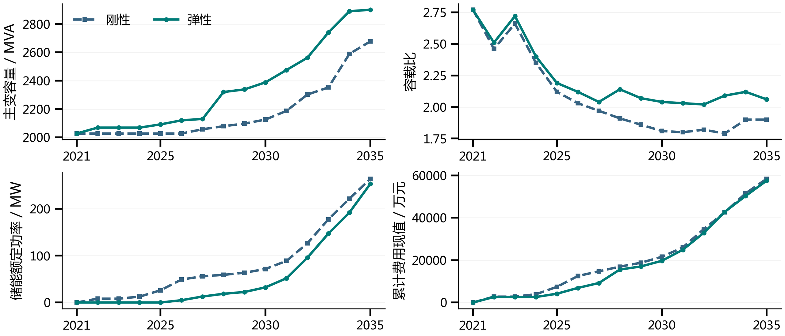

2035年弹性容载比2.06、主变2901.00 MVA；全期费用较刚性减少848.32万元。

依据：研究报告表5-4、表5-5、表5-9

- 16

### Speaker Notes

邳州弹性方案在若干建设节点形成更多站内容量，后期储能和联络需求相应改变。2035年弹性主变2901.00 MVA、容载比2.06，刚性分别为2678.00 MVA、1.90。全期弹性费用57521.36万元，比刚性减少848.32万元。

## Slide 17

4

实证分析

4.2 市区逐年方案

市区费用优势由建设时序和联络替代逐步形成

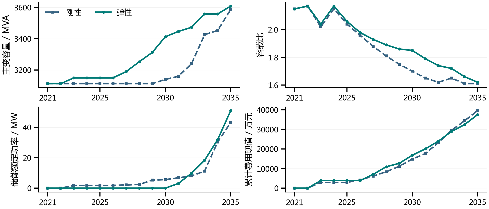

2022年两方案相同，2030年弹性累计费用仍较高；全期费用减少2050.35万元。

依据：研究报告表5-6、表5-7、表5-9

- 17

### Speaker Notes

市区2022年两方案相同，2030年弹性累计费用仍高于刚性，后续建设共同形成全期费用优势。2035年弹性主变3608.50 MVA、容载比1.62，储能额定能量109.65 MWh高于刚性92.88 MWh，累计新增联络则从66条降至35条。全期费用减少2050.35万元。

## Slide 18

4

实证分析

4.3 评价期费用分解

新增主变支出由其他措施费用下降部分抵消

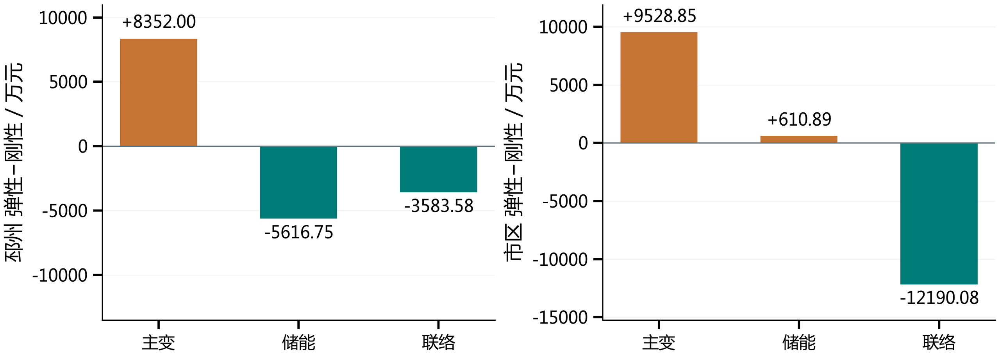

| 方案费用现值 / 万元 | 刚性 | 弹性 | 减少 |
| --- | --- | --- | --- |
| 两地区合计 | 98006.53 | 95107.86 | 2898.67 |

依据：研究报告表5-9、表5-11

- 18

### Speaker Notes

两地区弹性方案的主变费用均增加，但储能及联络费用变化不同。邳州储能和联络费用下降共同抵消新增主变支出；市区主要由联络费用下降形成优势，储能费用略增。两地区合计费用现值减少2898.67万元，降幅2.96%。

## Slide 19

4

实证分析

4.4 2035年设备组合

两类片区通过不同措施组合满足局部供电任务

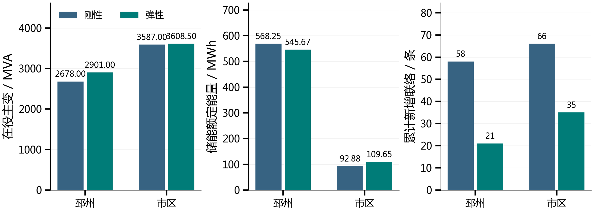

邳州弹性储能与联络均减少；市区弹性储能增加、联络减少，需分别解释。

依据：研究报告表5-10

- 19

### Speaker Notes

2035年邳州弹性储能545.67 MWh、累计新增联络21条，刚性分别为568.25 MWh、58条。市区弹性储能109.65 MWh高于刚性，但累计新增联络35条低于刚性66条。容量、储能和联络必须作为同一配置组合比较。

## Slide 20

4

实证分析

4.5 代表站设备分析

主变台数组合改变N-1剩余能力及局部支撑需求

| 2035年站点 | 刚性主变 / MVA | 弹性主变 / MVA | 差异对应的任务 |
| --- | --- | --- | --- |
| 戴圩变 | 50+63 | 50+63+50 | 弹性扩建第三台，减少本地配储 |
| 兴塘变 | 31.5+40+50 | 31.5+50+50 | 故障后剩余容量71.50→81.50 MVA |
| 八义集变 | 50+63 | 50+63 | 容量相同，储能功率3.10→0.30 MW |

设备位置与台数

年度转接与本地储能

增容效果取决于最大单台停运后剩余的实际设
备组合

相同区域容量可对应不同转供任务及支撑规模

依据：研究报告表5-13、表5-15、表5-31及对应逐站分析

- 20

### Speaker Notes

戴圩变弹性方案扩建第三台50 MVA主变，2035年总容量由刚性113.00 MVA提高到163.00 MVA，配储需求改变。兴塘变通过不同主变组合提高N-1剩余容量；八义集变则在总容量相同条件下，储能和年度固定转接任务不同。逐站解释均对应本站实际配置。

## Slide 21

4

实证分析

4.6 联络与共享资源

转供支援由源端、路径及接收侧能力共同决定

正常方式与主变N-1分别安排年度固定转供方案

源端站

共享馈线与联络

受端站

可切换源荷区段

既有MW额度及通道热限

馈线余量与主变容量

多条联络共用馈线与区段预算

新增联络：485 A折算7.98 MW，工程取8.00 MW；示例区段有效转供7.49 MW。

区段内负荷与光伏共同切换，区域内同小时转出与承接保持平衡。

依据：研究报告3.6、5.5、表5-59—5-61

- 21

### Speaker Notes

联络将具体源荷区段切换至有余量的受端，负荷和区段内光伏共同切换。既有转供能力以逐站MW封顶，正常与事故追加共同占用路径和共享馈线预算。10 kV、485 A和功率因数0.95按三相有功关系折算为7.98 MW，工程取8.00 MW，示例区段有效转供7.49 MW。新增工程按实际项目计费，支撑作用通过源端可切负荷、通道和受端主变校核。

## Slide 22

4

实证分析

4.7 五参数推荐范围

按片区条件定位推荐带，再核定具体设备方案

① 电缆占比

② 负荷分散

③ 源荷条件

④ 初始转供

增长率与装机渗透率选
行

确定三类造价分区

按1.15划分两档

定位推荐区间列

| 初始转供率 | ≤30% | (30%,50%] | (50%,70%] | >70% |
| --- | --- | --- | --- | --- |
| 推荐容载比 | 1.96～2.03 | 1.89～1.96 | 1.63～1.69 | 1.57～1.63 |

示例条件：电缆长度占比≤10%，负荷分散系数≤1.15，

年最大净负荷平均增长率>7%，装机渗透率(1,2]。

六表288单元；基准宽0.10、定位网格0.02，接近容量水平按中点共用界值。

依据：研究报告5.6、表3-21、表5-63

- 22

### Speaker Notes

矩阵先按三档电缆占比和两档负荷分散系数选表，再以增长率和装机渗透率选行、初始转供率选列。示例四档推荐窗口为1.96至2.03、1.89至1.96、1.63至1.69、1.57至1.63。各格由最接近中位数的真实节点定位基准宽0.10窗口，同距取较大值，定位网格为0.02，相近容量水平按中点共用界值并局部缩窄。查表后按实际主变、扩建位置和网络条件形成设备方案。

## Slide 23

4

实证分析

4.8 参数响应与设备切换

网络支援改善体现为分档推荐带和设备组合变化

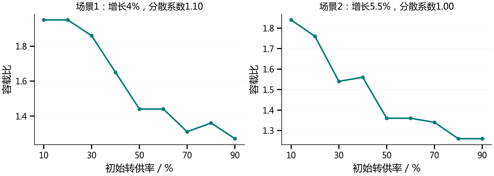

装机与负荷增长改变容量任务；电缆造价和局部峰值分布可触发措施替代。

两组均保留9个转供节点，平台与局部回升对应真实设备组合。

依据：研究报告表5-69—5-75

- 23

### Speaker Notes

两组典型转供场景在设备重新选配条件下保留10%至90%的九个细节点，容量随转供改善总体降低，同时存在真实平台和局部回升。装机渗透率提高影响反向任务，增长率同时改变负荷分母与建设需求，电缆造价和局部峰值分散则在部分节点触发措施替代。推荐范围与具体设备响应共同使用。

## Slide 24

5

项目成效

5.1 研究成果与规划应用

形成从运行特征到片区工程建议的完整研究链条

运行特征与参数

工程成本与联合配置

46站分析、两层筛选及五项参数，解释地区差
异

主变、储能和联络费用，逐年正常与N-1共同
校核

地区方案与推荐范围

一片一策应用

两地区建设路径、分项费用，六张条件推荐矩
阵

先查表，再落实设备和投运时点，结合新增资
料滚动更新

工程实施继续核实真实馈线、连续SOC、电压与保护条件，完善运行费用与资产价值。

依据：研究报告第六章、5.7

- 24

### Speaker Notes

研究形成运行特征、工程费用、地区逐年方案和五参数推荐矩阵四类成果。两地区所设条件下弹性费用现值合计降低2.96%，具体建设路径随片区源荷和网络条件变化。工程采用时还需核定连续储能运行、实际网络及相关费用条件，滚动更新设备与推荐范围。

## Slide 25

谢 谢！

- 25

### Speaker Notes

汇报完毕，敬请各位专家批评指正。

## Slide 26

6

备查资料

备查：逐年配置

邳州逐年主变、储能及累计新增联络对照

| 年份 | 刚性容量 | 刚性比值 | 刚性储能 | 刚性新线 | 弹性容量 | 弹性比值 | 弹性储能 | 弹性新线 |
| --- | --- | --- | --- | --- | --- | --- | --- | --- |
| 2021 | 2027.00 | 2.77 | 0.00 | 0 | 2027.00 | 2.77 | 0.00 | 0 |
| 2022 | 2027.00 | 2.46 | 8.20 | 4 | 2068.50 | 2.51 | 0.00 | 0 |
| 2023 | 2027.00 | 2.66 | 8.20 | 4 | 2068.50 | 2.72 | 0.00 | 0 |
| 2024 | 2027.00 | 2.35 | 12.50 | 5 | 2068.50 | 2.40 | 0.00 | 0 |
| 2025 | 2027.00 | 2.12 | 26.20 | 9 | 2091.50 | 2.19 | 0.00 | 3 |
| 2026 | 2027.00 | 2.03 | 49.10 | 13 | 2120.00 | 2.12 | 4.90 | 3 |
| 2027 | 2057.00 | 1.97 | 56.00 | 14 | 2130.00 | 2.04 | 12.80 | 3 |
| 2028 | 2078.50 | 1.91 | 59.10 | 18 | 2320.00 | 2.14 | 18.60 | 3 |
| 2029 | 2097.00 | 1.86 | 63.60 | 22 | 2338.50 | 2.07 | 22.50 | 4 |
| 2030 | 2125.50 | 1.81 | 71.60 | 25 | 2388.50 | 2.04 | 32.40 | 6 |
| 2031 | 2187.00 | 1.80 | 88.90 | 33 | 2475.50 | 2.03 | 51.80 | 10 |
| 2032 | 2302.50 | 1.82 | 126.60 | 40 | 2562.50 | 2.02 | 95.90 | 12 |
| 2033 | 2352.50 | 1.79 | 177.80 | 51 | 2741.00 | 2.09 | 147.40 | 14 |
| 2034 | 2589.50 | 1.90 | 221.80 | 53 | 2891.00 | 2.12 | 192.20 | 18 |
| 2035 | 2678.00 | 1.90 | 264.30 | 58 | 2901.00 | 2.06 | 253.80 | 21 |

单位：容量MVA，储能为在役额定功率MW；新线为累计新增联络条数。

依据：研究报告表5-4

- 26

### Speaker Notes

本页逐年列示刚性和弹性方案的在役容量、容载比、储能额定功率和累计新增联络。历史年度为同一模型下的回算，未来为报告预测条件下的结果。

## Slide 27

6

备查资料

备查：逐年配置

市区逐年主变、储能及累计新增联络对照

| 年份 | 刚性容量 | 刚性比值 | 刚性储能 | 刚性新线 | 弹性容量 | 弹性比值 | 弹性储能 | 弹性新线 |
| --- | --- | --- | --- | --- | --- | --- | --- | --- |
| 2021 | 3113.50 | 2.15 | 0.00 | 0 | 3113.50 | 2.15 | 0.00 | 0 |
| 2022 | 3113.50 | 2.17 | 0.00 | 0 | 3113.50 | 2.17 | 0.00 | 0 |
| 2023 | 3113.50 | 2.02 | 1.80 | 5 | 3150.50 | 2.04 | 0.00 | 0 |
| 2024 | 3113.50 | 2.15 | 1.80 | 5 | 3150.50 | 2.17 | 0.00 | 0 |
| 2025 | 3113.50 | 2.04 | 1.80 | 5 | 3150.50 | 2.06 | 0.00 | 0 |
| 2026 | 3113.50 | 1.96 | 1.80 | 8 | 3150.50 | 1.98 | 0.00 | 0 |
| 2027 | 3113.50 | 1.88 | 2.10 | 13 | 3190.50 | 1.93 | 0.00 | 0 |
| 2028 | 3113.50 | 1.81 | 2.40 | 19 | 3253.00 | 1.89 | 0.00 | 0 |
| 2029 | 3113.50 | 1.75 | 5.30 | 26 | 3313.00 | 1.86 | 0.00 | 0 |
| 2030 | 3140.50 | 1.70 | 5.60 | 32 | 3413.00 | 1.85 | 0.00 | 0 |
| 2031 | 3160.50 | 1.65 | 6.80 | 37 | 3447.00 | 1.79 | 3.10 | 3 |
| 2032 | 3240.50 | 1.62 | 8.00 | 48 | 3473.00 | 1.74 | 9.80 | 9 |
| 2033 | 3426.00 | 1.65 | 11.20 | 55 | 3558.50 | 1.72 | 18.30 | 16 |
| 2034 | 3453.00 | 1.61 | 30.30 | 61 | 3558.50 | 1.66 | 31.90 | 24 |
| 2035 | 3587.00 | 1.61 | 43.20 | 66 | 3608.50 | 1.62 | 51.00 | 35 |

单位：容量MVA，储能为在役额定功率MW；新线为累计新增联络条数。

依据：研究报告表5-6

- 27

### Speaker Notes

本页逐年列示刚性和弹性方案的在役容量、容载比、储能额定功率和累计新增联络。历史年度为同一模型下的回算，未来为报告预测条件下的结果。

## Slide 28

6

备查资料

备查：方法与经济参数

采样设计、有效样本和共同经济条件分别登记

| 候选指标 | 取点/计算 | 有效组数 | 有效节点数 |
| --- | --- | --- | --- |
| 装机渗透率 | 25 | 2484 | 32112 |
| 电量渗透率 | 27 | 19880 | 60798 |
| 站级负载率最大值 | 由源荷节点计算 | 19880 | 60798 |
| 最大正向净负荷 | 由源荷节点计算 | 11988 | 88781 |
| 最大反向净负荷 | 由源荷节点计算 | 19880 | 60798 |
| 年最大净负荷平均增长率 | 14 | 4329 | 32112 |
| 95%峰值持续时间 | 8 | 5140 | 41118 |
| 负荷分散系数 | 11 | 10608 | 31473 |
| 初始转供率 | 9 | 4680 | 32058 |
| 主变/线路投资比 | 7个价格节点 | 2466 | 17262 |
| 主变/储能投资比 | 7个价格节点 | 2466 | 17262 |
| 电缆长度占比 | 5 | 7584 | 32112 |
| 储能支撑持续时间 | 8 | 10704 | 32112 |

寿命：主变/线路/储能40/40/25年；维护费率4.2%/2.2%/3%；折现率6%。

评价基准2021年、截止2041年；采样实际取值节点保留于报告表3-14。

依据：研究报告表3-14、表3-15、表4-1

- 28

### Speaker Notes

候选参数的取点与有效统计样本分别列示，参数间相关阈值仅用于本研究维度归纳。所有地区方案采用相同寿命、维护费率、折现率与共同评价期。

## Slide 29

6

备查资料

备查：容载比推荐矩阵

电缆长度占比≤10%，负荷分散系数≤1.15

| 年最大净负荷平均增长率 | 装机渗透率 | ≤30% | (30%,50%] | (50%,70%] | >70% |
| --- | --- | --- | --- | --- | --- |
| ≤2% | ≤1 | 1.95～2.05 | 1.95～2.05 | 1.95～2.05 | 1.95～2.05 |
| ≤2% | (1,2] | 2.15～2.25 | 1.99～2.09 | 1.99～2.09 | 1.99～2.09 |
| ≤2% | >2 | 2.75～2.85 | 2.57～2.67 | 2.57～2.67 | 2.57～2.67 |
| (2%,4%] | ≤1 | 2.01～2.11 | 1.73～1.83 | 1.73～1.83 | 1.73～1.83 |
| (2%,4%] | (1,2] | 2.09～2.19 | 1.92～2.01 | 1.83～1.92 | 1.83～1.92 |
| (2%,4%] | >2 | 2.65～2.75 | 2.37～2.47 | 2.37～2.47 | 2.37～2.47 |
| (4%,7%] | ≤1 | 1.93～2.03 | 1.73～1.83 | 1.57～1.67 | 1.57～1.67 |
| (4%,7%] | (1,2] | 2.05～2.15 | 1.81～1.89 | 1.73～1.81 | 1.73～1.81 |
| (4%,7%] | >2 | 2.45～2.55 | 2.45～2.55 | 2.25～2.35 | 2.15～2.25 |
| >7% | ≤1 | 1.88～1.97 | 1.79～1.88 | 1.57～1.67 | 1.43～1.53 |
| >7% | (1,2] | 1.96～2.03 | 1.89～1.96 | 1.63～1.69 | 1.57～1.63 |
| >7% | >2 | 2.41～2.47 | 2.35～2.41 | 2.19～2.29 | 2.09～2.19 |

列为初始转供率；窗口基准宽0.10，相近水平按中点局部接续。

依据：研究报告表5-63

- 29

### Speaker Notes

本页负荷分散系数≤1.15，完整列出相应电缆占比分区下的推荐窗口。读取行列时同时核对增长率、装机渗透率及初始转供率。系数仿真范围1.05至1.25，每0.02取点，窗口用于初步容量比选。

## Slide 30

6

备查资料

备查：容载比推荐矩阵

电缆长度占比≤10%，负荷分散系数>1.15

| 年最大净负荷平均增长率 | 装机渗透率 | ≤30% | (30%,50%] | (50%,70%] | >70% |
| --- | --- | --- | --- | --- | --- |
| ≤2% | ≤1 | 2.17～2.27 | 1.95～2.05 | 1.95～2.05 | 1.95～2.05 |
| ≤2% | (1,2] | 2.27～2.37 | 1.99～2.09 | 1.99～2.09 | 1.99～2.09 |
| ≤2% | >2 | 2.79～2.89 | 2.57～2.67 | 2.57～2.67 | 2.57～2.67 |
| (2%,4%] | ≤1 | 2.17～2.27 | 1.91～2.01 | 1.73～1.83 | 1.73～1.83 |
| (2%,4%] | (1,2] | 2.27～2.37 | 1.92～2.01 | 1.83～1.92 | 1.83～1.92 |
| (2%,4%] | >2 | 2.75～2.85 | 2.47～2.57 | 2.37～2.47 | 2.37～2.47 |
| (4%,7%] | ≤1 | 2.08～2.15 | 2.01～2.08 | 1.73～1.83 | 1.57～1.67 |
| (4%,7%] | (1,2] | 2.08～2.15 | 2.01～2.08 | 1.73～1.83 | 1.73～1.83 |
| (4%,7%] | >2 | 2.52～2.59 | 2.45～2.52 | 2.33～2.43 | 2.15～2.25 |
| >7% | ≤1 | 2.02～2.11 | 1.93～2.02 | 1.73～1.83 | 1.45～1.55 |
| >7% | (1,2] | 2.01～2.07 | 2.07～2.13 | 1.87～1.97 | 1.57～1.67 |
| >7% | >2 | 2.46～2.55 | 2.37～2.46 | 2.27～2.37 | 2.09～2.19 |

列为初始转供率；窗口基准宽0.10，相近水平按中点局部接续。

依据：研究报告表5-64

- 30

### Speaker Notes

本页负荷分散系数>1.15，完整列出相应电缆占比分区下的推荐窗口。读取行列时同时核对增长率、装机渗透率及初始转供率。系数仿真范围1.05至1.25，每0.02取点，窗口用于初步容量比选。

## Slide 31

6

备查资料

备查：容载比推荐矩阵

电缆长度占比(10%,30%]，负荷分散系数≤1.15

| 年最大净负荷平均增长率 | 装机渗透率 | ≤30% | (30%,50%] | (50%,70%] | >70% |
| --- | --- | --- | --- | --- | --- |
| ≤2% | ≤1 | 2.02～2.09 | 1.95～2.02 | 1.95～2.02 | 1.95～2.02 |
| ≤2% | (1,2] | 2.15～2.25 | 1.99～2.09 | 1.99～2.09 | 1.99～2.09 |
| ≤2% | >2 | 2.75～2.85 | 2.57～2.67 | 2.57～2.67 | 2.57～2.67 |
| (2%,4%] | ≤1 | 2.01～2.11 | 1.73～1.83 | 1.73～1.83 | 1.73～1.83 |
| (2%,4%] | (1,2] | 2.09～2.19 | 1.92～2.01 | 1.83～1.92 | 1.83～1.92 |
| (2%,4%] | >2 | 2.65～2.75 | 2.47～2.57 | 2.37～2.47 | 2.37～2.47 |
| (4%,7%] | ≤1 | 1.93～2.03 | 1.73～1.83 | 1.57～1.67 | 1.57～1.67 |
| (4%,7%] | (1,2] | 2.05～2.15 | 1.81～1.89 | 1.73～1.81 | 1.73～1.81 |
| (4%,7%] | >2 | 2.45～2.55 | 2.45～2.55 | 2.25～2.35 | 2.25～2.35 |
| >7% | ≤1 | 1.88～1.97 | 1.79～1.88 | 1.57～1.67 | 1.43～1.53 |
| >7% | (1,2] | 1.96～2.03 | 1.89～1.96 | 1.63～1.69 | 1.57～1.63 |
| >7% | >2 | 2.41～2.47 | 2.35～2.41 | 2.19～2.29 | 2.09～2.19 |

列为初始转供率；窗口基准宽0.10，相近水平按中点局部接续。

依据：研究报告表5-65

- 31

### Speaker Notes

本页负荷分散系数≤1.15，完整列出相应电缆占比分区下的推荐窗口。读取行列时同时核对增长率、装机渗透率及初始转供率。系数仿真范围1.05至1.25，每0.02取点，窗口用于初步容量比选。

## Slide 32

6

备查资料

备查：容载比推荐矩阵

电缆长度占比(10%,30%]，负荷分散系数>1.15

| 年最大净负荷平均增长率 | 装机渗透率 | ≤30% | (30%,50%] | (50%,70%] | >70% |
| --- | --- | --- | --- | --- | --- |
| ≤2% | ≤1 | 2.17～2.27 | 1.95～2.05 | 1.95～2.05 | 1.95～2.05 |
| ≤2% | (1,2] | 2.27～2.37 | 1.99～2.09 | 1.99～2.09 | 1.99～2.09 |
| ≤2% | >2 | 2.79～2.89 | 2.57～2.67 | 2.57～2.67 | 2.57～2.67 |
| (2%,4%] | ≤1 | 2.17～2.27 | 1.91～2.01 | 1.73～1.83 | 1.73～1.83 |
| (2%,4%] | (1,2] | 2.27～2.37 | 2.01～2.11 | 1.83～1.93 | 1.83～1.93 |
| (2%,4%] | >2 | 2.75～2.85 | 2.47～2.57 | 2.37～2.47 | 2.37～2.47 |
| (4%,7%] | ≤1 | 2.08～2.15 | 2.01～2.08 | 1.73～1.83 | 1.57～1.67 |
| (4%,7%] | (1,2] | 2.08～2.15 | 2.01～2.08 | 1.73～1.83 | 1.73～1.83 |
| (4%,7%] | >2 | 2.52～2.59 | 2.45～2.52 | 2.34～2.43 | 2.25～2.34 |
| >7% | ≤1 | 2.02～2.11 | 1.93～2.02 | 1.73～1.83 | 1.45～1.55 |
| >7% | (1,2] | 2.01～2.07 | 2.07～2.13 | 1.89～1.99 | 1.57～1.67 |
| >7% | >2 | 2.46～2.55 | 2.37～2.46 | 2.27～2.37 | 2.09～2.19 |

列为初始转供率；窗口基准宽0.10，相近水平按中点局部接续。

依据：研究报告表5-66

- 32

### Speaker Notes

本页负荷分散系数>1.15，完整列出相应电缆占比分区下的推荐窗口。读取行列时同时核对增长率、装机渗透率及初始转供率。系数仿真范围1.05至1.25，每0.02取点，窗口用于初步容量比选。

## Slide 33

6

备查资料

备查：容载比推荐矩阵

电缆长度占比>30%，负荷分散系数≤1.15

| 年最大净负荷平均增长率 | 装机渗透率 | ≤30% | (30%,50%] | (50%,70%] | >70% |
| --- | --- | --- | --- | --- | --- |
| ≤2% | ≤1 | 2.02～2.09 | 1.95～2.02 | 1.95～2.02 | 1.95～2.02 |
| ≤2% | (1,2] | 2.15～2.25 | 1.99～2.09 | 1.99～2.09 | 1.99～2.09 |
| ≤2% | >2 | 2.79～2.89 | 2.57～2.67 | 2.57～2.67 | 2.57～2.67 |
| (2%,4%] | ≤1 | 2.01～2.11 | 1.83～1.93 | 1.73～1.83 | 1.73～1.83 |
| (2%,4%] | (1,2] | 2.09～2.19 | 1.92～2.01 | 1.83～1.92 | 1.83～1.92 |
| (2%,4%] | >2 | 2.65～2.75 | 2.47～2.57 | 2.37～2.47 | 2.37～2.47 |
| (4%,7%] | ≤1 | 1.93～2.03 | 1.79～1.89 | 1.65～1.73 | 1.57～1.65 |
| (4%,7%] | (1,2] | 2.05～2.15 | 1.89～1.99 | 1.73～1.83 | 1.73～1.83 |
| (4%,7%] | >2 | 2.45～2.55 | 2.45～2.55 | 2.25～2.35 | 2.25～2.35 |
| >7% | ≤1 | 1.88～1.97 | 1.79～1.88 | 1.57～1.67 | 1.43～1.53 |
| >7% | (1,2] | 1.96～2.03 | 1.89～1.96 | 1.73～1.83 | 1.57～1.67 |
| >7% | >2 | 2.41～2.47 | 2.35～2.41 | 2.19～2.29 | 2.19～2.29 |

列为初始转供率；窗口基准宽0.10，相近水平按中点局部接续。

依据：研究报告表5-67

- 33

### Speaker Notes

本页负荷分散系数≤1.15，完整列出相应电缆占比分区下的推荐窗口。读取行列时同时核对增长率、装机渗透率及初始转供率。系数仿真范围1.05至1.25，每0.02取点，窗口用于初步容量比选。

## Slide 34

6

备查资料

备查：容载比推荐矩阵

电缆长度占比>30%，负荷分散系数>1.15

| 年最大净负荷平均增长率 | 装机渗透率 | ≤30% | (30%,50%] | (50%,70%] | >70% |
| --- | --- | --- | --- | --- | --- |
| ≤2% | ≤1 | 2.17～2.27 | 2.02～2.09 | 1.95～2.02 | 1.95～2.02 |
| ≤2% | (1,2] | 2.27～2.37 | 2.15～2.25 | 1.99～2.09 | 1.99～2.09 |
| ≤2% | >2 | 2.79～2.89 | 2.63～2.69 | 2.57～2.63 | 2.57～2.63 |
| (2%,4%] | ≤1 | 2.17～2.27 | 1.92～2.01 | 1.83～1.92 | 1.73～1.83 |
| (2%,4%] | (1,2] | 2.27～2.37 | 2.01～2.11 | 1.92～2.01 | 1.83～1.92 |
| (2%,4%] | >2 | 2.75～2.85 | 2.47～2.57 | 2.37～2.47 | 2.37～2.47 |
| (4%,7%] | ≤1 | 2.08～2.15 | 2.01～2.08 | 1.73～1.83 | 1.57～1.67 |
| (4%,7%] | (1,2] | 2.05～2.15 | 2.05～2.15 | 1.81～1.89 | 1.73～1.81 |
| (4%,7%] | >2 | 2.52～2.59 | 2.48～2.52 | 2.41～2.48 | 2.25～2.35 |
| >7% | ≤1 | 2.02～2.11 | 1.95～2.02 | 1.87～1.95 | 1.45～1.55 |
| >7% | (1,2] | 2.01～2.07 | 2.07～2.13 | 1.89～1.99 | 1.57～1.67 |
| >7% | >2 | 2.46～2.55 | 2.37～2.46 | 2.28～2.37 | 2.19～2.28 |

列为初始转供率；窗口基准宽0.10，相近水平按中点局部接续。

依据：研究报告表5-68

- 34

### Speaker Notes

本页负荷分散系数>1.15，完整列出相应电缆占比分区下的推荐窗口。读取行列时同时核对增长率、装机渗透率及初始转供率。系数仿真范围1.05至1.25，每0.02取点，窗口用于初步容量比选。

## Slide 35

6

备查资料

备查：四类参数响应

参数通过不同工程机制触发容量配置切换

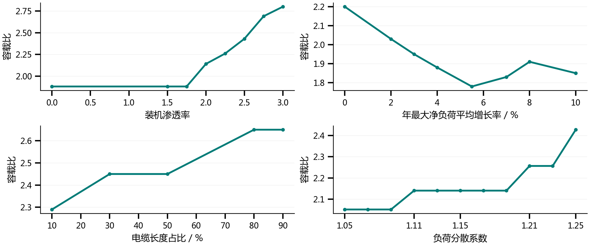

分散系数三个增容节点形成四个平台，平台内储能和联络仍有调整。

依据：研究报告表5-72—5-75

- 35

### Speaker Notes

装机渗透率、增长率、电缆长度占比和负荷分散系数分别改变源荷任务、比值分母、线路造价和局部峰值条件。负荷分散系数完整11节点中，1.11、1.21和1.25触发增容，形成2.05、2.14、2.26、2.43四个容量平台。平台内仍需调整储能和联络，完整节点见下一页。

## Slide 36

6

备查资料

备查：局部高峰与设备替代

容量平台内的储能和联络仍随局部高峰调整

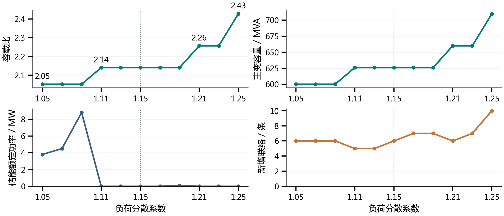

固定条件：装机渗透率2.00，年最大净负荷平均增长率4%，电缆10%，转供40%。

1.11增容替代8.80 MW储能；1.21再次增容取消储能，1.25配10项联络。

依据：研究报告5.6.8、表5-75及对应11节点序列

- 36

### Speaker Notes

完整保留1.05至1.25、间隔0.02的11个节点，其余源荷和网络条件相同。1.11增容26 MVA替代8.80 MW储能并减少一项联络；其后同一容量平台内继续调整配套措施。1.21再次增容并取消储能，1.25容量达到710 MVA、配10项联络。全序列费用现值从4310.32万元增至8339.97万元。
