# source

- Source: `source.pptx`
- Total slides: 38

## Slide 1

徐州地区分布式新能源高渗透率地区
110 kV电网容载比弹性指标优化研究
成果汇报

国网江苏电力设计咨询有限公司
徐州勘测设计分公司
2026年10月

### Speaker Notes

本次汇报围绕分布式新能源高渗透率下110 kV电网容载比与双向容量需求的协调问题，介绍运行特征、工程成本、联合配置结果及规划应用建议。

## Slide 2

一

研究背景

二

研究目标和思路

三

研究内容

四

实证分析

五

项目成效

### Speaker Notes

汇报分为五部分。首先说明规划问题和研究思路，然后介绍运行分析与成本模型，重点报告两地区逐年方案及五参数推荐范围，最后说明成果和应用条件。

## Slide 3

1

研究背景

1.1 背景与规划问题

光伏接入使主变同时承担正向供电与反向输送任务

日间：本地消纳与余电反送

晚间：上级电网供电

双向运行

日间光伏优先供应本地负荷，剩
余电力经主变反送；晚间光伏退
出，主变继续承担正向供电任务
。

区域与站级

区域容载比由主变容量和年网供
最大负荷共同决定，站级需求还
受主变台数、局部峰值和邻站支
援影响。

反向容量校核

正向峰值与主变N-1校核

- 研究任务：结合邳州与市区源荷特征，在正常运行和主变N-1条件下联合比选主变、储能与10
kV联络，形成分片区的容量规划建议。

依据：研究报告1.1—1.2；《配电网规划设计技术导则（修订稿，2025年4月）》

- 1

### Speaker Notes

光伏出力较高时，本地负荷由分布式电源供给，剩余功率可能通过主变向上级电网反送。晚间光伏退出后，主变仍承担正向供电。研究据此把区域容载比与逐站正反向容量、主变N-1和站间支援联系起来。

## Slide 4

研究背景

一

研究目标和思路

二

三

研究内容

四

实证分析

五

项目成效

2

### Speaker Notes

下面进入研究目标和思路部分。

## Slide 5

2

研究目标和思路

2.1 研究目标与思路

把片区推荐值落实为满足供电任务的工程配置

① 运行资料

② 运行任务

③ 工程费用

整理年度容量、同范围负荷和光
伏，匹配46座站的设备、净负
荷与既有转供资料。

按同小时功率关系识别正向供电
、日间反送及局部近峰过程，明
确站级容量需求。

区分主变更换与扩建，按储能柜
数和新增联络项目计费，并统一
折算投运批次费用。

④ 联合比选

⑤ 结果解释

⑥ 条件推荐

逐年承接已投运设备，在正常与
主变N-1约束下共同选择主变、
储能和联络措施。

联系设备台数组合、建设节点与
分项费用，解释地区差异及各措
施的替代关系。

由十三项候选指标筛选五项参数
，按片区条件组织推荐矩阵，再
落实具体工程方案。

- 研究输出：由运行特征、费用与设备结果形成五参数推荐范围，服务分片区容量规划。

依据：研究报告1.4—1.5、图1-1

- 3

### Speaker Notes

研究先从年度统计和站级资料识别运行任务，再用真实工程造价建立统一费用模型。在相同供电条件下联合选择主变、联络和储能，通过逐年设备与费用结果解释弹性容量的作用，并归纳五参数推荐范围。

## Slide 6

研究背景

一

二

研究目标和思路

研究内容

三

四

实证分析

五

项目成效

4

### Speaker Notes

下面进入研究内容部分。

## Slide 7

3

研究内容

3.1 研究对象与数据

邳州与市区分别体现高光伏县域和负荷集中城区

| 2025年指标 | 邳州 | 市区 |
| --- | --- | --- |
| 站级分析范围 | 20座110 kV站 | 26座110 kV站 |
| 实际主变容量 / MVA | 2139.50 | 3701.00 |
| 年网供最大负荷 / MW | 956.45 | 1528.82 |
| 装机渗透率估计值 | 1.63 | 0.32 |
| 电量渗透率估计值 | 40% | 9% |

- 统计与仿真：现状统计描述实际容量与源荷；逐年方案以2021年实际容量为共同起点，2022—2025
年为历史回算，2026—2035年为预测条件规划。

- 指标含义：装机渗透率为光伏装机与用户最大负荷之比，电量渗透率为光伏年发电量占用户年用电
量的比例；本页两项均为报告估计值。

依据：研究报告3.1、表3-12、表5-1

- 5

### Speaker Notes

两地区保留各自源荷与设备特征，站级分析覆盖邳州20座和市区26座110 kV变电站。历史统计用于描述现状，逐年方案以2021年实际容量为共同起点。时序样本按报告方法补齐为8760小时，装机和电量渗透率中相应估计范围保留。

## Slide 8

3

研究内容

3.2 历史容量与负荷

两地区容载比变化反映不同的建设与负荷发展过程

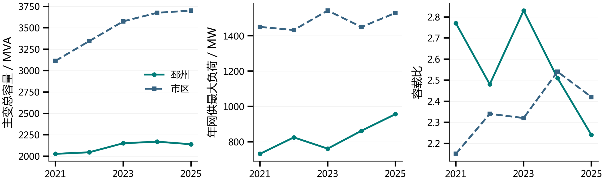

- 邳州：2021—2025年容量增加112.50 MVA、负荷增加224.68 MW，负荷增长快于容量增长，容载
比由2.77降至2.24。

- 市区：同期容量增加587.50 MVA，负荷增加79.05 MW，容载比由2.15升至2.42；年度比值需结
合容量投放与负荷回落共同解释。

依据：研究报告表3-1、表3-2、表3-24

- 6

### Speaker Notes

2021—2025年邳州主变容量增加112.50 MVA，年网供最大负荷增加224.68 MW，容载比由2.77降至2.24。市区同期容量增加587.50 MVA，负荷增加79.05 MW，容载比由2.15升至2.42。比值需同时联系容量和负荷，而年度回落年份还应保留已投运设备的作用。

## Slide 9

3

研究内容

3.3 光伏发展与渗透率

光伏规模及供能水平差异形成不同的双向运行任务

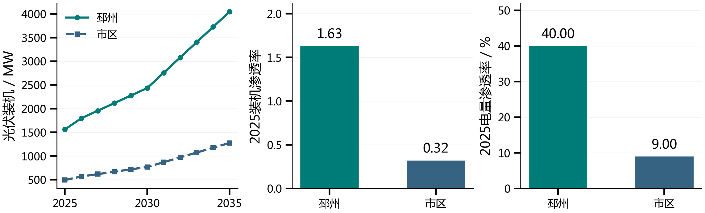

- 地区差异：2025年邳州光伏装机1559.64 MW、市区491.18 MW，装机与电量渗透水平均为邳州
较高，日间反送任务更突出。

- 规划作用：光伏出力改变正反向净负荷，容量校核需同时覆盖日间反送和晚间供电；未来装机按
报告预测情景输入，并与负荷预测共同作用。

依据：研究报告3.3、表3-6、表3-12

- 7

### Speaker Notes

邳州2025年末光伏装机为1559.64 MW，市区为491.18 MW。两地区的装机和电量渗透率表明，邳州更需关注日间反送。未来光伏按报告的全市相对发展比例形成情景，并与负荷预测分别输入。

## Slide 10

3

研究内容

3.4 净负荷与近峰特征

正反向峰值及持续过程共同决定容量与支撑需求

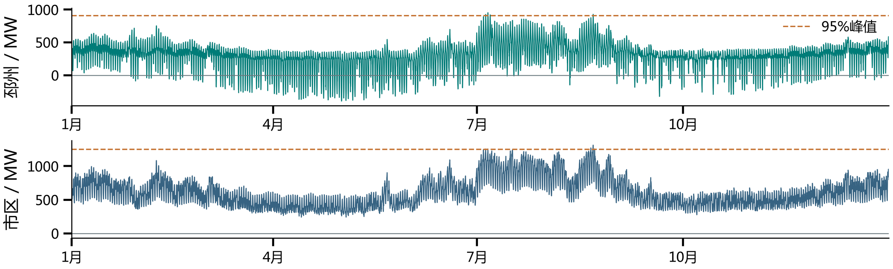

- 近峰过程：以区域净负荷绝对峰值的95%为阈值，邳州最长连续2 h、累计7 h，市区分别为6 h、
11 h，反映两地区持续支撑任务的差异。

- 计算关系：先按同一小时汇总站级净负荷再取区域峰值，统计使用补齐后的8760小时序列；年度
容载比继续采用年度统计峰值。

依据：研究报告3.4、表3-10；保留补值标识的区域8760小时序列

- 8

### Speaker Notes

净负荷受入为正、反送为负，图中保留补齐后的全年序列。近峰阈值为区域净负荷绝对峰值的95%，邳州最长连续2小时、市区6小时。该统计描述运行过程，年度容载比仍使用年度统计峰值。

## Slide 11

3

研究内容

3.5 站级容量压力

区域容量储备与少数站点的局部压力可以同时存在

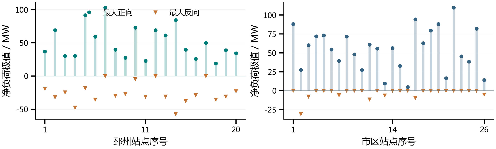

- 空间差异：46座站分别呈现正向与反向容量任务，邳州4座、市区1座站反向幅值较大，区域容量
储备与少数站局部压力可以同时存在。

- 设备判断：本站可用能力取决于主变结构及N-1剩余容量，邻站支援还受路径和受端余量限制；
应把站级净负荷、设备与转供条件共同纳入比选。

依据：研究报告表3-8、表3-22、表3-23

- 9

### Speaker Notes

46座站的正反向极值展示了容量任务在空间上的差异。邳州有4座站反向幅值较大，市区有1座，其他站以正向任务为主。站级负载率是按容量和功率因数折算的计算指标，与逐台设备实测年最大负载率分别使用。

## Slide 12

3

研究内容

3.6 核心指标筛选

十三项指标经组内筛选与高相关归并形成五项参数

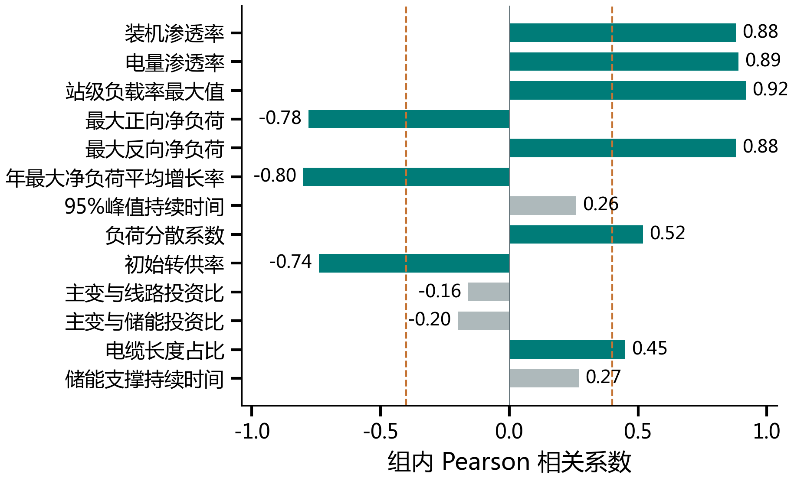

① 十三项候选

覆盖源荷、网络、峰段与工程价
格，先明确各指标的定义和取值
。

② 九项关联指标

组内相关绝对值达到0.40，保
留能够反映容载比变化的信息。

③ 五项基础参数

按0.70高相关阈值归并，优先
采用具有明确规划含义的基础输
入。

- 统计说明：采用受控组内Pearson相关、节点等权并保留零响应组。0.40与0.70用于本研究参数归纳
，筛选结果结合计算关系和规划含义解释。

依据：研究报告3.5、表3-14—3-20

- 10

### Speaker Notes

首先在固定其他条件的受控组内，计算候选指标与容载比的Pearson相关，保留零容量响应组。十三项中九项达到绝对值0.40，再以参数间绝对值0.70归并信息重叠较多的组，优先采用具有明确规划含义的基础输入，形成五项推广参数。

## Slide 13

3

研究内容

3.7 参数核验与分档

五项参数分别保留不同规划条件的信息

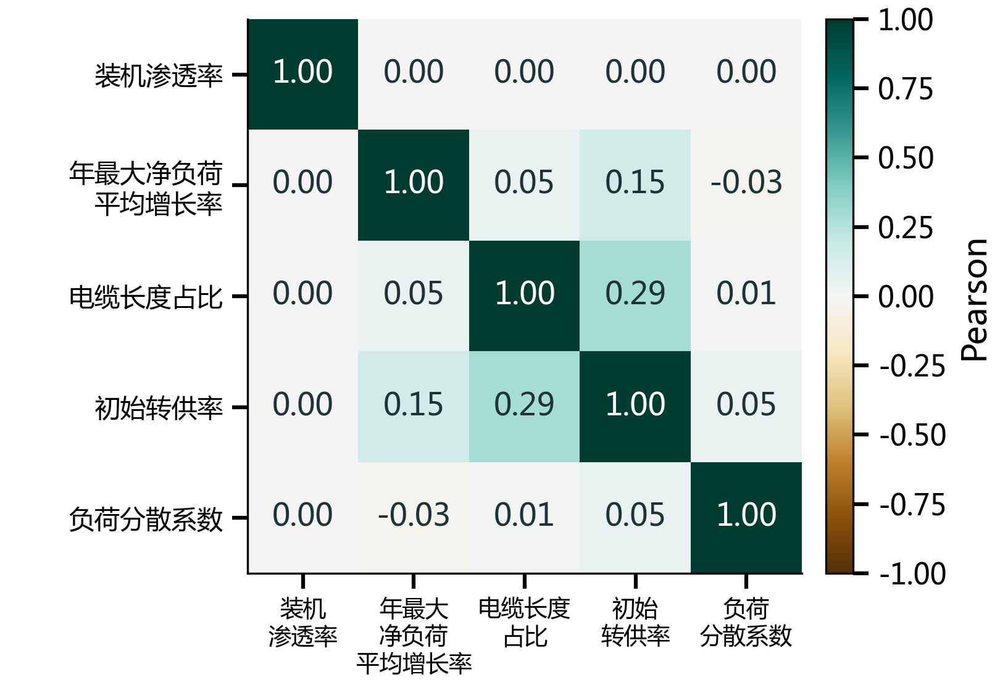

| 参数 | 矩阵分类 |
| --- | --- |
| 装机渗透率 | ≤1；(1,2]；>2 |
| 年最大净负荷平均增长率 | ≤2%；(2%,4%]；(4%,7%]；>7% |
| 电缆长度占比 | ≤10%；(10%,30%]；>30% |
| 初始转供率 | ≤30%；(30%,50%]；(50%,70%]；>70% |
| 负荷分散系数 | ≤1.15；>1.15 |

- 五项参数分别保留电源规模、负荷发展、联络造价、既有支援和局部峰值分布的信息。有效情景库
内最大参数间Pearson绝对值为0.29，结合计算关系核验后用于推广分档。

依据：研究报告表3-19、表3-21

- 11

### Speaker Notes

五项参数为装机渗透率、年最大净负荷平均增长率、电缆长度占比、初始转供率和负荷分散系数。有效情景库中最大参数间相关绝对值为0.29，五项保留电源规模、负荷发展、线路经济条件、既有支援和局部峰值分布的信息。

## Slide 14

3

研究内容

3.8 主变工程投资

按新购整台容量计费，容量净增另行统计

工程案例与加权系数

更换与扩建分别计价

单位：万元/MVA；按采购容量加权。

| 工程 | 投资/万元 | 新购/MVA | 净增/MVA |
| --- | --- | --- | --- |
| 王庄 | 1151.00 | 50.00 | 30.00 |
| 鲁庙 | 1335.00 | 100.00 | 37.00 |

更换状态取0或1，新旧容量以MVA计。扩建为50
MVA整项，1223.00万元/项，限具备预留位置的站
点。

更换费用按整台新购容量计取，容量净增扣除被
替换容量；参考系数包含配套工程。

共同条件：正常负载率≤80%、主变N-1短时≤130%。刚性保留2.0新增容量控制，弹性放宽该上限；同一主
变位置全期最多更换一次。

依据：研究报告4.1—4.2，式（4-1）—（4-3）

- 12

### Speaker Notes

主变更换按整台新购容量计价，净增容量扣除原有被替换设备。王庄与鲁庙工程形成16.57万元每MVA的采购容量加权参考系数。扩建按50 MVA完整项目1223万元计取，限具备预留位置的站点。刚性与弹性方案采用相同供电安全要求，只对新增容量控制作区别。

## Slide 15

3

研究内容

3.9 10 kV联络投资

电缆占比决定造价，接入费单独计取

计价参数：投资单位万元，线路长度L
以km计；电缆长度占比α取0—1。架空
24万元/km，电缆综合180万元/km。

项目边界：基准长度3 km，另加两台
等效开关6.00万元；固定接入费保持
独立。

地区单价：邳州128.38、市区452.40
万元/项。既有工程不重复计建设费，
新增按投运条数计费；校核源端、共享
通道及受端余量。

依据：研究报告4.3，式（4-4）、表4-3

- 13

### Speaker Notes

联络投资由线路敷设与固定接入两部分构成。电缆长度占比通过成本系数进入线路造价，3 km基准工程另计6万元等效开关接入费。邳州和市区单项投资分别为128.38万元和452.40万元，按实际新增投运条数计算。支援还需满足送端可转负荷、共享通道与受端容量条件。

## Slide 16

3

研究内容

3.10 储能采购与有效支撑

新增整数柜决定投资，功率与可用电量共同限制支撑

柜型100 kW/215 kWh；10柜成套成交210.46万元，按新增整数柜采购。

单柜参考21.05万元；n为在役柜数，Δn为当年新增整数柜数，H为支撑时长/h，B为有效功率/MW。

| 支撑时长 / h | 2 | 4 | 6 |
| --- | --- | --- | --- |
| 10柜有效功率 / MW | 0.82 | 0.41 | 0.27 |
| 1.00 MW所需柜数 / 柜 | 13 | 25 | 37 |

正向支撑与反向吸收分别采用对应时长；0.76包含SOC可用窗口与单向放电效率，按静态功率折算，实际
运行再核定充电、恢复及连续SOC。

依据：研究报告4.4，式（4-5）—（4-6）、表4-5

- 14

### Speaker Notes

储能采购按100 kW、215 kWh整柜计费，成套项目折算参考单柜21.05万元。有效功率取额定功率和可用电量除以时长的较小值，0.76综合反映SOC可用窗口与单向放电效率。承担1 MW连续支撑任务，2、4、6小时分别需要13、25、37柜。正反向分别采用相应时长，运行应用继续核定充电、恢复和连续SOC。

## Slide 17

3

研究内容

3.11 现金流现值与评价边界

同一截止年下比较完整建设路径费用

I为初始投资/万元，y为投运年，L为寿命/年，q为固定运维率；基准为2021年末，r=6.00%，T=2041，C
为费用现值/万元。

| 共同参数 | 主变 | 联络 | 储能 |
| --- | --- | --- | --- |
| 寿命 / 固定运维率 | 40年 / 4.20% | 40年 / 2.20% | 25年 / 3.00% |

投运与更新：初始投资在投运年发生，固定运维从次年计至2041年；更新年严格早于2041年，本期2022—
2035年投运设备的更新支出为零。
费用范围：纳入新增建设及固定运维；既有建设费、期末残值、被替换设备运维变化、储能购电与损耗及
收益抵扣不纳入。

依据：研究报告4.6，单项工程现值及方案汇总公式

- 15

### Speaker Notes

各投运批次的初始投资、更新和固定运维统一折算至2021年末，再按主变、储能和线路项目集合汇总。固定运维从投运次年计至2041年，更新要求投运年加整倍寿命严格早于2041年。本期2022至2035年投运设备均未触发更新，因此现值比较覆盖新增建设和固定运维。期末残值、替换存量设备运维变化、储能购电和损耗、收益抵扣等尚未纳入，费用降幅按这一共同范围解释。

其中，方案费用现值由建设改造项目的费用现值相加得到，三类投运项目集合分别对应主变、储能和线路，费用单位均为万元。

## Slide 18

研究背景

一

二

研究目标和思路

三

研究内容

实证分析

四

五

项目成效

16

### Speaker Notes

下面进入实证分析部分。

## Slide 19

4

实证分析

4.1 邳州逐年方案

邳州弹性方案增加站内容量并减少部分配套需求

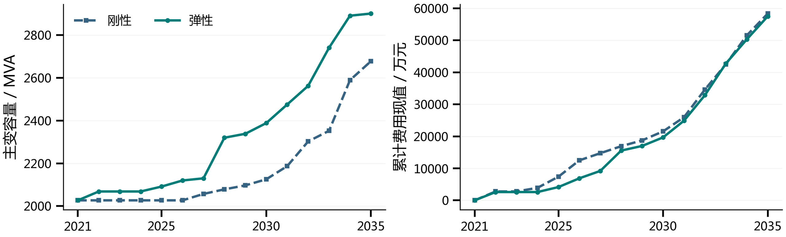

- 容量路径：弹性方案在局部需求出现时增加站内容量，2035年达到2901.00 MVA、容载比2.06；
刚性分别为2678.00 MVA、1.90。

- 措施替代：期末弹性储能545.67 MWh、累计新增联络21条，均低于刚性。储能及联络支出下降抵
消较多主变投入，全期费用减少848.32万元。

依据：研究报告表5-4、表5-5、表5-9

- 17

### Speaker Notes

邳州弹性方案在若干建设节点形成更多站内容量，后期储能和联络需求相应改变。2035年弹性主变2901.00 MVA、容载比2.06，刚性分别为2678.00 MVA、1.90。全期弹性费用57521.36万元，比刚性减少848.32万元。

## Slide 20

4

实证分析

4.2 市区逐年方案

市区费用优势由建设时序和联络替代逐步形成

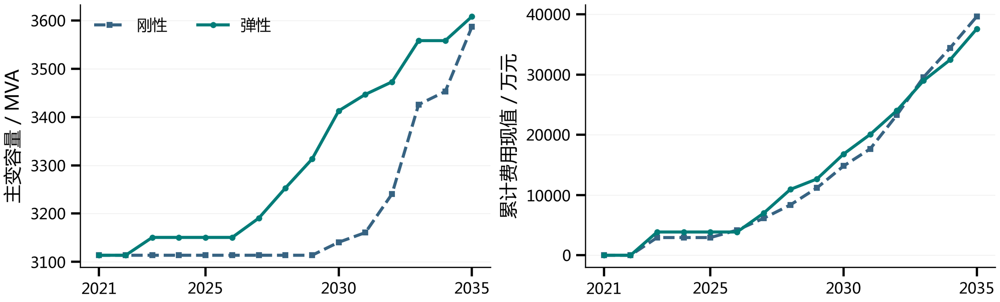

| 比较项目 | 刚性方案 | 弹性方案 | 工程含义 |
| --- | --- | --- | --- |
| 2030累计费用 / 万元 | 14819.77 | 16806.54 | 弹性前期站内补强投入较多 |
| 2035储能 / MWh | 92.88 | 109.65 | 期末储能配置高于刚性 |
| 2035新增联络累计 / 条 | 66 | 35 | 联络建设减少 |
| 全期费用现值 / 万元 | 39636.85 | 37586.50 | 联络费用下降，合计减少2050.35万元 |

依据：研究报告表5-6、表5-7、表5-9

- 18

### Speaker Notes

市区2022年两方案相同，2030年弹性累计费用仍高于刚性，后续建设共同形成全期费用优势。2035年弹性主变3608.50 MVA、容载比1.62，储能额定能量109.65 MWh高于刚性92.88 MWh，累计新增联络则从66条降至35条。全期费用减少2050.35万元。

## Slide 21

4

实证分析

4.3 评价期费用分解

新增主变支出由其他措施费用下降部分抵消

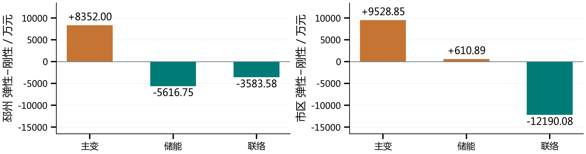

| 地区 | 刚性 / 万元 | 弹性 / 万元 | 减少 / 万元 | 主要费用变化 |
| --- | --- | --- | --- | --- |
| 邳州 | 58369.68 | 57521.36 | 848.32 | 储能及联络支出下降，抵消较多主变投入 |
| 市区 | 39636.85 | 37586.50 | 2050.35 | 主要由联络费用下降形成优势 |
| 合计 | 98006.53 | 95107.86 | 2898.67 | 总费用降幅2.96% |

依据：研究报告表5-9、表5-11

- 19

### Speaker Notes

两地区弹性方案的主变费用均增加，但储能及联络费用变化不同。邳州储能和联络费用下降共同抵消新增主变支出；市区主要由联络费用下降形成优势，储能费用略增。两地区合计费用现值减少2898.67万元，降幅2.96%。

## Slide 22

4

实证分析

4.4 2035年设备组合

两类片区通过不同措施组合满足局部供电任务

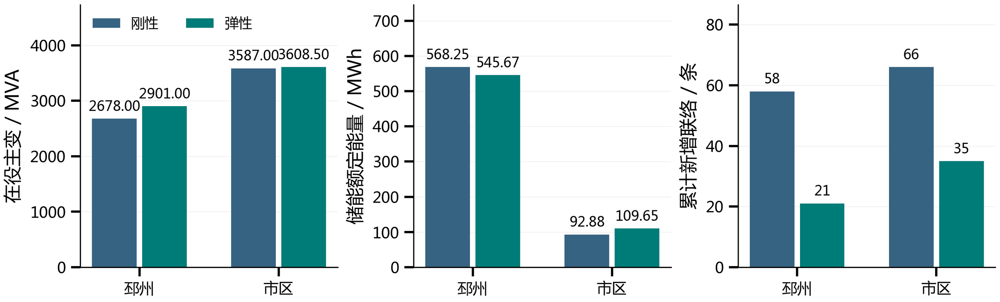

- 邳州组合：弹性主变容量较大，期末储能由刚性568.25 MWh减至545.67 MWh，累计新增联络由
58条减至21条，站内容量与配套支撑共同调整。

- 市区组合：弹性主变仅较刚性多21.50 MVA，储能增加而联络减少。区域容量接近时，各站缺口
和建设时点仍会形成不同的支撑配置与费用。

依据：研究报告表5-10

- 20

### Speaker Notes

2035年邳州弹性储能545.67 MWh、累计新增联络21条，刚性分别为568.25 MWh、58条。市区弹性储能109.65 MWh高于刚性，但累计新增联络35条低于刚性66条。容量、储能和联络必须作为同一配置组合比较。

## Slide 23

4

实证分析

4.5 代表站设备分析

主变台数组合改变N-1剩余能力及局部支撑需求

| 2035年站点 | 刚性主变 / MVA | 弹性主变 / MVA | 差异对应的任务 |
| --- | --- | --- | --- |
| 戴圩变 | 50+63 | 50+63+50 | 弹性扩建第三台，减少本地配储 |
| 兴塘变 | 31.5+40+50 | 31.5+50+50 | 故障后剩余容量71.50→81.50 MVA |
| 八义集变 | 50+63 | 50+63 | 容量相同，储能功率3.10→0.30 MW |

| 比较维度 | 代表站与结果 | 工程含义 |
| --- | --- | --- |
| 设备结构 | 兴塘变：N-1剩余容量71.50→81.50 MVA | 扩建第三台与更换已有主变，对故障后剩余能力的改善不同。 |
| 局部支撑 | 八义集变：主变容量相同，储能功率3.10→0.30 MW | 年度转接任务与配储需求存在差异，需结合源荷、受端及设备状态判断。 |

依据：研究报告表5-13、表5-15、表5-31及对应逐站分析

- 21

### Speaker Notes

戴圩变弹性方案扩建第三台50 MVA主变，2035年总容量由刚性113.00 MVA提高到163.00 MVA，配储需求改变。兴塘变通过不同主变组合提高N-1剩余容量；八义集变则在总容量相同条件下，储能和年度固定转接任务不同。逐站解释均对应本站实际配置。

## Slide 24

4

实证分析

4.6 联络与共享资源

转供支援由源端、路径及接收侧能力共同决定

正常方式与主变N-1分别安排年度固定转供方案

源端站

共享馈线与联络

受端站

可切换源荷区段

既有MW额度及通道热限

馈线余量与主变容量

多条联络共用馈线与区段预算

- 共同校核：区段内负荷与光伏一同切换，源端可切负荷、路径共享和受端主变余量共同限制转
供；正常与N-1分别采用年度固定方案。

- 工程取值：10 kV、485 A及功率因数0.95折算有功7.98 MW，工程上限取8.00 MW；示例区段
有效转供7.49 MW，新增项目按投运年计费。

依据：研究报告3.6、5.5、表5-59—5-61

- 22

### Speaker Notes

联络将具体源荷区段切换至有余量的受端，负荷和区段内光伏共同切换。既有转供能力以逐站MW封顶，正常与事故追加共同占用路径和共享馈线预算。10 kV、485 A和功率因数0.95按三相有功关系折算为7.98 MW，工程取8.00 MW，示例区段有效转供7.49 MW。新增工程按实际项目计费，支撑作用通过源端可切负荷、通道和受端主变校核。

## Slide 25

4

实证分析

4.7 五参数推荐范围

按片区条件定位推荐带，再核定具体设备方案

① 电缆占比

② 负荷分散

③ 源荷条件

④ 初始转供

增长率与装机渗透率选
行

确定三类造价分区

按1.15划分两档

定位推荐区间列

- 窗口用于容量初选，再按站级缺口、主变结构与可实施措施落实设备方案。

| 初始转供率 | ≤30% | (30%,50%] | (50%,70%] | >70% |
| --- | --- | --- | --- | --- |
| 推荐容载比 | 1.96～2.03 | 1.89～1.96 | 1.63～1.69 | 1.57～1.63 |

示例条件：电缆长度占比≤10%，负荷分散系数≤1.15，

年最大净负荷平均增长率>7%，装机渗透率(1,2]。

六表288单元；基准宽0.10、定位网格0.02，接近容量水平按中点共用界值。

依据：研究报告5.6、表3-21、表5-63

- 23

### Speaker Notes

矩阵先按三档电缆占比和两档负荷分散系数选表，再以增长率和装机渗透率选行、初始转供率选列。示例四档推荐窗口为1.96至2.03、1.89至1.96、1.63至1.69、1.57至1.63。各格由最接近中位数的真实节点定位基准宽0.10窗口，同距取较大值，定位网格为0.02，相近容量水平按中点共用界值并局部缩窄。查表后按实际主变、扩建位置和网络条件形成设备方案。

## Slide 26

4

实证分析

4.8 参数响应与设备切换

网络支援改善体现为分档推荐带和设备组合变化

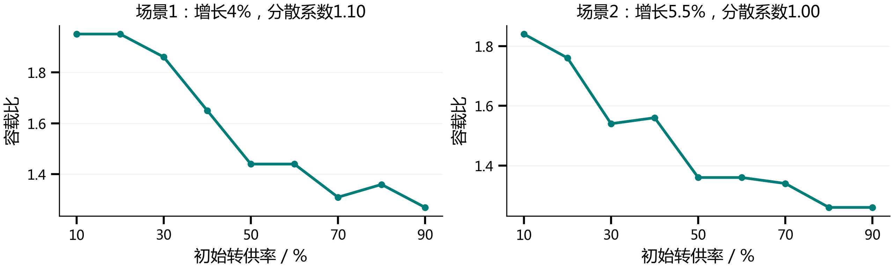

- 受控对照：两组均固定装机渗透率50%、电缆长度占比50%，采用设备重新选配条件，保留初始转
供率10%—90%的九个细节点。

- 响应机制：转供改善总体降低容量需求，平台与局部回升对应真实设备组合。其他参数分别改变
反向任务、负荷规模、线路造价和局部高峰，触发不同措施替代。

依据：研究报告表5-69—5-75

- 24

### Speaker Notes

两组典型转供场景在设备重新选配条件下保留10%至90%的九个细节点，容量随转供改善总体降低，同时存在真实平台和局部回升。装机渗透率提高影响反向任务，增长率同时改变负荷分母与建设需求，电缆造价和局部峰值分散则在部分节点触发措施替代。推荐范围与具体设备响应共同使用。

## Slide 27

研究背景

一

二

研究目标和思路

三

研究内容

四

实证分析

项目成效

五

25

### Speaker Notes

下面进入项目成效部分。

## Slide 28

5

项目成效

5.1 研究成果与规划应用

形成从运行特征到片区工程建议的完整研究链条

运行特征与参数

工程费用与联合配置

完成46站正反向任务分析，经两层筛选形成五项
参数，把电源、负荷、网络和局部峰值条件与容
量规划联系起来。

建立主变更换、扩建、储能柜和联络项目的统一
费用关系，在正常与N-1条件下逐年承接设备，解
释措施替代。

地区方案与推荐矩阵

一片一策落地

两地区弹性方案费用现值合计减少2898.67万元、
降幅2.96%。六表288单元提供有条件的容量初选
窗口。

先核定同范围源荷与网络参数，再查表并落实设
备、间隔和投运时点；结合真实馈线与储能运行
资料滚动更新。

- 应用条件：工程实施继续核定连续SOC、电压与保护条件，并补充运行费用和资产价值。

依据：研究报告第六章、5.7

- 26

### Speaker Notes

研究形成运行特征、工程费用、地区逐年方案和五参数推荐矩阵四类成果。两地区所设条件下弹性费用现值合计降低2.96%，具体建设路径随片区源荷和网络条件变化。工程采用时还需核定连续储能运行、实际网络及相关费用条件，滚动更新设备与推荐范围。

## Slide 29

谢 谢！

- 27

### Speaker Notes

汇报完毕，敬请各位专家批评指正。

## Slide 30

6

备查资料

备查：逐年配置

邳州逐年主变、储能及累计新增联络对照

| 年份 | 刚性容量 | 刚性比值 | 刚性储能 | 刚性新线 | 弹性容量 | 弹性比值 | 弹性储能 | 弹性新线 |
| --- | --- | --- | --- | --- | --- | --- | --- | --- |
| 2021 | 2027.00 | 2.77 | 0.00 | 0 | 2027.00 | 2.77 | 0.00 | 0 |
| 2022 | 2027.00 | 2.46 | 8.20 | 4 | 2068.50 | 2.51 | 0.00 | 0 |
| 2023 | 2027.00 | 2.66 | 8.20 | 4 | 2068.50 | 2.72 | 0.00 | 0 |
| 2024 | 2027.00 | 2.35 | 12.50 | 5 | 2068.50 | 2.40 | 0.00 | 0 |
| 2025 | 2027.00 | 2.12 | 26.20 | 9 | 2091.50 | 2.19 | 0.00 | 3 |
| 2026 | 2027.00 | 2.03 | 49.10 | 13 | 2120.00 | 2.12 | 4.90 | 3 |
| 2027 | 2057.00 | 1.97 | 56.00 | 14 | 2130.00 | 2.04 | 12.80 | 3 |
| 2028 | 2078.50 | 1.91 | 59.10 | 18 | 2320.00 | 2.14 | 18.60 | 3 |
| 2029 | 2097.00 | 1.86 | 63.60 | 22 | 2338.50 | 2.07 | 22.50 | 4 |
| 2030 | 2125.50 | 1.81 | 71.60 | 25 | 2388.50 | 2.04 | 32.40 | 6 |
| 2031 | 2187.00 | 1.80 | 88.90 | 33 | 2475.50 | 2.03 | 51.80 | 10 |
| 2032 | 2302.50 | 1.82 | 126.60 | 40 | 2562.50 | 2.02 | 95.90 | 12 |
| 2033 | 2352.50 | 1.79 | 177.80 | 51 | 2741.00 | 2.09 | 147.40 | 14 |
| 2034 | 2589.50 | 1.90 | 221.80 | 53 | 2891.00 | 2.12 | 192.20 | 18 |
| 2035 | 2678.00 | 1.90 | 264.30 | 58 | 2901.00 | 2.06 | 253.80 | 21 |

单位：容量MVA，储能为在役额定功率MW；新线为累计新增联络条数。

依据：研究报告表5-4

- 28

### Speaker Notes

本页逐年列示刚性和弹性方案的在役容量、容载比、储能额定功率和累计新增联络。历史年度为同一模型下的回算，未来为报告预测条件下的结果。

## Slide 31

6

备查资料

备查：逐年配置

市区逐年主变、储能及累计新增联络对照

| 年份 | 刚性容量 | 刚性比值 | 刚性储能 | 刚性新线 | 弹性容量 | 弹性比值 | 弹性储能 | 弹性新线 |
| --- | --- | --- | --- | --- | --- | --- | --- | --- |
| 2021 | 3113.50 | 2.15 | 0.00 | 0 | 3113.50 | 2.15 | 0.00 | 0 |
| 2022 | 3113.50 | 2.17 | 0.00 | 0 | 3113.50 | 2.17 | 0.00 | 0 |
| 2023 | 3113.50 | 2.02 | 1.80 | 5 | 3150.50 | 2.04 | 0.00 | 0 |
| 2024 | 3113.50 | 2.15 | 1.80 | 5 | 3150.50 | 2.17 | 0.00 | 0 |
| 2025 | 3113.50 | 2.04 | 1.80 | 5 | 3150.50 | 2.06 | 0.00 | 0 |
| 2026 | 3113.50 | 1.96 | 1.80 | 8 | 3150.50 | 1.98 | 0.00 | 0 |
| 2027 | 3113.50 | 1.88 | 2.10 | 13 | 3190.50 | 1.93 | 0.00 | 0 |
| 2028 | 3113.50 | 1.81 | 2.40 | 19 | 3253.00 | 1.89 | 0.00 | 0 |
| 2029 | 3113.50 | 1.75 | 5.30 | 26 | 3313.00 | 1.86 | 0.00 | 0 |
| 2030 | 3140.50 | 1.70 | 5.60 | 32 | 3413.00 | 1.85 | 0.00 | 0 |
| 2031 | 3160.50 | 1.65 | 6.80 | 37 | 3447.00 | 1.79 | 3.10 | 3 |
| 2032 | 3240.50 | 1.62 | 8.00 | 48 | 3473.00 | 1.74 | 9.80 | 9 |
| 2033 | 3426.00 | 1.65 | 11.20 | 55 | 3558.50 | 1.72 | 18.30 | 16 |
| 2034 | 3453.00 | 1.61 | 30.30 | 61 | 3558.50 | 1.66 | 31.90 | 24 |
| 2035 | 3587.00 | 1.61 | 43.20 | 66 | 3608.50 | 1.62 | 51.00 | 35 |

单位：容量MVA，储能为在役额定功率MW；新线为累计新增联络条数。

依据：研究报告表5-6

- 29

### Speaker Notes

本页逐年列示刚性和弹性方案的在役容量、容载比、储能额定功率和累计新增联络。历史年度为同一模型下的回算，未来为报告预测条件下的结果。

## Slide 32

6

备查资料

备查：方法与经济参数

采样设计、有效样本和共同经济条件分别登记

| 候选指标 | 取点/计算 | 有效组数 | 有效节点数 |
| --- | --- | --- | --- |
| 装机渗透率 | 25 | 2484 | 32112 |
| 电量渗透率 | 27 | 19880 | 60798 |
| 站级负载率最大值 | 由源荷节点计算 | 19880 | 60798 |
| 最大正向净负荷 | 由源荷节点计算 | 11988 | 88781 |
| 最大反向净负荷 | 由源荷节点计算 | 19880 | 60798 |
| 年最大净负荷平均增长率 | 14 | 4329 | 32112 |
| 95%峰值持续时间 | 8 | 5140 | 41118 |
| 负荷分散系数 | 11 | 10608 | 31473 |
| 初始转供率 | 9 | 4680 | 32058 |
| 主变/线路投资比 | 7个价格节点 | 2466 | 17262 |
| 主变/储能投资比 | 7个价格节点 | 2466 | 17262 |
| 电缆长度占比 | 5 | 7584 | 32112 |
| 储能支撑持续时间 | 8 | 10704 | 32112 |

寿命：主变/线路/储能40/40/25年；维护费率4.2%/2.2%/3%；折现率6%。

评价基准2021年、截止2041年；采样实际取值节点保留于报告表3-14。

依据：研究报告表3-14、表3-15、表4-1

- 30

### Speaker Notes

候选参数的取点与有效统计样本分别列示，参数间相关阈值仅用于本研究维度归纳。所有地区方案采用相同寿命、维护费率、折现率与共同评价期。

## Slide 33

6

备查资料

备查：容载比推荐矩阵

电缆长度占比≤10%，负荷分散系数≤1.15

| 年最大净负荷平均增长率 | 装机渗透率 | ≤30% | (30%,50%] | (50%,70%] | >70% |
| --- | --- | --- | --- | --- | --- |
| ≤2% | ≤1 | 1.95～2.05 | 1.95～2.05 | 1.95～2.05 | 1.95～2.05 |
| ≤2% | (1,2] | 2.15～2.25 | 1.99～2.09 | 1.99～2.09 | 1.99～2.09 |
| ≤2% | >2 | 2.75～2.85 | 2.57～2.67 | 2.57～2.67 | 2.57～2.67 |
| (2%,4%] | ≤1 | 2.01～2.11 | 1.73～1.83 | 1.73～1.83 | 1.73～1.83 |
| (2%,4%] | (1,2] | 2.09～2.19 | 1.92～2.01 | 1.83～1.92 | 1.83～1.92 |
| (2%,4%] | >2 | 2.65～2.75 | 2.37～2.47 | 2.37～2.47 | 2.37～2.47 |
| (4%,7%] | ≤1 | 1.93～2.03 | 1.73～1.83 | 1.57～1.67 | 1.57～1.67 |
| (4%,7%] | (1,2] | 2.05～2.15 | 1.81～1.89 | 1.73～1.81 | 1.73～1.81 |
| (4%,7%] | >2 | 2.45～2.55 | 2.45～2.55 | 2.25～2.35 | 2.15～2.25 |
| >7% | ≤1 | 1.88～1.97 | 1.79～1.88 | 1.57～1.67 | 1.43～1.53 |
| >7% | (1,2] | 1.96～2.03 | 1.89～1.96 | 1.63～1.69 | 1.57～1.63 |
| >7% | >2 | 2.41～2.47 | 2.35～2.41 | 2.19～2.29 | 2.09～2.19 |

列为初始转供率；窗口基准宽0.10，相近水平按中点局部接续。

依据：研究报告表5-63

- 31

### Speaker Notes

本页负荷分散系数≤1.15，完整列出相应电缆占比分区下的推荐窗口。读取行列时同时核对增长率、装机渗透率及初始转供率。系数仿真范围1.05至1.25，每0.02取点，窗口用于初步容量比选。

## Slide 34

6

备查资料

备查：容载比推荐矩阵

电缆长度占比≤10%，负荷分散系数>1.15

| 年最大净负荷平均增长率 | 装机渗透率 | ≤30% | (30%,50%] | (50%,70%] | >70% |
| --- | --- | --- | --- | --- | --- |
| ≤2% | ≤1 | 2.17～2.27 | 1.95～2.05 | 1.95～2.05 | 1.95～2.05 |
| ≤2% | (1,2] | 2.27～2.37 | 1.99～2.09 | 1.99～2.09 | 1.99～2.09 |
| ≤2% | >2 | 2.79～2.89 | 2.57～2.67 | 2.57～2.67 | 2.57～2.67 |
| (2%,4%] | ≤1 | 2.17～2.27 | 1.91～2.01 | 1.73～1.83 | 1.73～1.83 |
| (2%,4%] | (1,2] | 2.27～2.37 | 1.92～2.01 | 1.83～1.92 | 1.83～1.92 |
| (2%,4%] | >2 | 2.75～2.85 | 2.47～2.57 | 2.37～2.47 | 2.37～2.47 |
| (4%,7%] | ≤1 | 2.08～2.15 | 2.01～2.08 | 1.73～1.83 | 1.57～1.67 |
| (4%,7%] | (1,2] | 2.08～2.15 | 2.01～2.08 | 1.73～1.83 | 1.73～1.83 |
| (4%,7%] | >2 | 2.52～2.59 | 2.45～2.52 | 2.33～2.43 | 2.15～2.25 |
| >7% | ≤1 | 2.02～2.11 | 1.93～2.02 | 1.73～1.83 | 1.45～1.55 |
| >7% | (1,2] | 2.01～2.07 | 2.07～2.13 | 1.87～1.97 | 1.57～1.67 |
| >7% | >2 | 2.46～2.55 | 2.37～2.46 | 2.27～2.37 | 2.09～2.19 |

列为初始转供率；窗口基准宽0.10，相近水平按中点局部接续。

依据：研究报告表5-64

- 32

### Speaker Notes

本页负荷分散系数>1.15，完整列出相应电缆占比分区下的推荐窗口。读取行列时同时核对增长率、装机渗透率及初始转供率。系数仿真范围1.05至1.25，每0.02取点，窗口用于初步容量比选。

## Slide 35

6

备查资料

备查：容载比推荐矩阵

电缆长度占比(10%,30%]，负荷分散系数≤1.15

| 年最大净负荷平均增长率 | 装机渗透率 | ≤30% | (30%,50%] | (50%,70%] | >70% |
| --- | --- | --- | --- | --- | --- |
| ≤2% | ≤1 | 2.02～2.09 | 1.95～2.02 | 1.95～2.02 | 1.95～2.02 |
| ≤2% | (1,2] | 2.15～2.25 | 1.99～2.09 | 1.99～2.09 | 1.99～2.09 |
| ≤2% | >2 | 2.75～2.85 | 2.57～2.67 | 2.57～2.67 | 2.57～2.67 |
| (2%,4%] | ≤1 | 2.01～2.11 | 1.73～1.83 | 1.73～1.83 | 1.73～1.83 |
| (2%,4%] | (1,2] | 2.09～2.19 | 1.92～2.01 | 1.83～1.92 | 1.83～1.92 |
| (2%,4%] | >2 | 2.65～2.75 | 2.47～2.57 | 2.37～2.47 | 2.37～2.47 |
| (4%,7%] | ≤1 | 1.93～2.03 | 1.73～1.83 | 1.57～1.67 | 1.57～1.67 |
| (4%,7%] | (1,2] | 2.05～2.15 | 1.81～1.89 | 1.73～1.81 | 1.73～1.81 |
| (4%,7%] | >2 | 2.45～2.55 | 2.45～2.55 | 2.25～2.35 | 2.25～2.35 |
| >7% | ≤1 | 1.88～1.97 | 1.79～1.88 | 1.57～1.67 | 1.43～1.53 |
| >7% | (1,2] | 1.96～2.03 | 1.89～1.96 | 1.63～1.69 | 1.57～1.63 |
| >7% | >2 | 2.41～2.47 | 2.35～2.41 | 2.19～2.29 | 2.09～2.19 |

列为初始转供率；窗口基准宽0.10，相近水平按中点局部接续。

依据：研究报告表5-65

- 33

### Speaker Notes

本页负荷分散系数≤1.15，完整列出相应电缆占比分区下的推荐窗口。读取行列时同时核对增长率、装机渗透率及初始转供率。系数仿真范围1.05至1.25，每0.02取点，窗口用于初步容量比选。

## Slide 36

6

备查资料

备查：容载比推荐矩阵

电缆长度占比(10%,30%]，负荷分散系数>1.15

| 年最大净负荷平均增长率 | 装机渗透率 | ≤30% | (30%,50%] | (50%,70%] | >70% |
| --- | --- | --- | --- | --- | --- |
| ≤2% | ≤1 | 2.17～2.27 | 1.95～2.05 | 1.95～2.05 | 1.95～2.05 |
| ≤2% | (1,2] | 2.27～2.37 | 1.99～2.09 | 1.99～2.09 | 1.99～2.09 |
| ≤2% | >2 | 2.79～2.89 | 2.57～2.67 | 2.57～2.67 | 2.57～2.67 |
| (2%,4%] | ≤1 | 2.17～2.27 | 1.91～2.01 | 1.73～1.83 | 1.73～1.83 |
| (2%,4%] | (1,2] | 2.27～2.37 | 2.01～2.11 | 1.83～1.93 | 1.83～1.93 |
| (2%,4%] | >2 | 2.75～2.85 | 2.47～2.57 | 2.37～2.47 | 2.37～2.47 |
| (4%,7%] | ≤1 | 2.08～2.15 | 2.01～2.08 | 1.73～1.83 | 1.57～1.67 |
| (4%,7%] | (1,2] | 2.08～2.15 | 2.01～2.08 | 1.73～1.83 | 1.73～1.83 |
| (4%,7%] | >2 | 2.52～2.59 | 2.45～2.52 | 2.34～2.43 | 2.25～2.34 |
| >7% | ≤1 | 2.02～2.11 | 1.93～2.02 | 1.73～1.83 | 1.45～1.55 |
| >7% | (1,2] | 2.01～2.07 | 2.07～2.13 | 1.89～1.99 | 1.57～1.67 |
| >7% | >2 | 2.46～2.55 | 2.37～2.46 | 2.27～2.37 | 2.09～2.19 |

列为初始转供率；窗口基准宽0.10，相近水平按中点局部接续。

依据：研究报告表5-66

- 34

### Speaker Notes

本页负荷分散系数>1.15，完整列出相应电缆占比分区下的推荐窗口。读取行列时同时核对增长率、装机渗透率及初始转供率。系数仿真范围1.05至1.25，每0.02取点，窗口用于初步容量比选。

## Slide 37

6

备查资料

备查：容载比推荐矩阵

电缆长度占比>30%，负荷分散系数≤1.15

| 年最大净负荷平均增长率 | 装机渗透率 | ≤30% | (30%,50%] | (50%,70%] | >70% |
| --- | --- | --- | --- | --- | --- |
| ≤2% | ≤1 | 2.02～2.09 | 1.95～2.02 | 1.95～2.02 | 1.95～2.02 |
| ≤2% | (1,2] | 2.15～2.25 | 1.99～2.09 | 1.99～2.09 | 1.99～2.09 |
| ≤2% | >2 | 2.79～2.89 | 2.57～2.67 | 2.57～2.67 | 2.57～2.67 |
| (2%,4%] | ≤1 | 2.01～2.11 | 1.83～1.93 | 1.73～1.83 | 1.73～1.83 |
| (2%,4%] | (1,2] | 2.09～2.19 | 1.92～2.01 | 1.83～1.92 | 1.83～1.92 |
| (2%,4%] | >2 | 2.65～2.75 | 2.47～2.57 | 2.37～2.47 | 2.37～2.47 |
| (4%,7%] | ≤1 | 1.93～2.03 | 1.79～1.89 | 1.65～1.73 | 1.57～1.65 |
| (4%,7%] | (1,2] | 2.05～2.15 | 1.89～1.99 | 1.73～1.83 | 1.73～1.83 |
| (4%,7%] | >2 | 2.45～2.55 | 2.45～2.55 | 2.25～2.35 | 2.25～2.35 |
| >7% | ≤1 | 1.88～1.97 | 1.79～1.88 | 1.57～1.67 | 1.43～1.53 |
| >7% | (1,2] | 1.96～2.03 | 1.89～1.96 | 1.73～1.83 | 1.57～1.67 |
| >7% | >2 | 2.41～2.47 | 2.35～2.41 | 2.19～2.29 | 2.19～2.29 |

列为初始转供率；窗口基准宽0.10，相近水平按中点局部接续。

依据：研究报告表5-67

- 35

### Speaker Notes

本页负荷分散系数≤1.15，完整列出相应电缆占比分区下的推荐窗口。读取行列时同时核对增长率、装机渗透率及初始转供率。系数仿真范围1.05至1.25，每0.02取点，窗口用于初步容量比选。

## Slide 38

6

备查资料

备查：容载比推荐矩阵

电缆长度占比>30%，负荷分散系数>1.15

| 年最大净负荷平均增长率 | 装机渗透率 | ≤30% | (30%,50%] | (50%,70%] | >70% |
| --- | --- | --- | --- | --- | --- |
| ≤2% | ≤1 | 2.17～2.27 | 2.02～2.09 | 1.95～2.02 | 1.95～2.02 |
| ≤2% | (1,2] | 2.27～2.37 | 2.15～2.25 | 1.99～2.09 | 1.99～2.09 |
| ≤2% | >2 | 2.79～2.89 | 2.63～2.69 | 2.57～2.63 | 2.57～2.63 |
| (2%,4%] | ≤1 | 2.17～2.27 | 1.92～2.01 | 1.83～1.92 | 1.73～1.83 |
| (2%,4%] | (1,2] | 2.27～2.37 | 2.01～2.11 | 1.92～2.01 | 1.83～1.92 |
| (2%,4%] | >2 | 2.75～2.85 | 2.47～2.57 | 2.37～2.47 | 2.37～2.47 |
| (4%,7%] | ≤1 | 2.08～2.15 | 2.01～2.08 | 1.73～1.83 | 1.57～1.67 |
| (4%,7%] | (1,2] | 2.05～2.15 | 2.05～2.15 | 1.81～1.89 | 1.73～1.81 |
| (4%,7%] | >2 | 2.52～2.59 | 2.48～2.52 | 2.41～2.48 | 2.25～2.35 |
| >7% | ≤1 | 2.02～2.11 | 1.95～2.02 | 1.87～1.95 | 1.45～1.55 |
| >7% | (1,2] | 2.01～2.07 | 2.07～2.13 | 1.89～1.99 | 1.57～1.67 |
| >7% | >2 | 2.46～2.55 | 2.37～2.46 | 2.28～2.37 | 2.19～2.28 |

列为初始转供率；窗口基准宽0.10，相近水平按中点局部接续。

依据：研究报告表5-68

- 36

### Speaker Notes

本页负荷分散系数>1.15，完整列出相应电缆占比分区下的推荐窗口。读取行列时同时核对增长率、装机渗透率及初始转供率。系数仿真范围1.05至1.25，每0.02取点，窗口用于初步容量比选。
